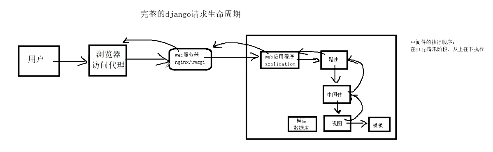

# 主流框架

重量级框架：Django
轻量级框架：FastAPI，flask，tornado，sanic，twsited 

# 使用uv安装Django

## 第一步：安装 uv

```bash
curl -LsSf https://astral.sh/uv/install.sh | sh
```

## 第二步：初始化项目并添加 Django

1. **创建项目并进入目录**

`uv`会自动创建项目结构、虚拟环境和`pyproject.toml`文件

```bash
uv init my-django-app
cd my-django-app
```

2. **添加 Django 依赖**

使用 `uv add` 命令安装 Django，它会自动更新 `pyproject.toml` 并安装到虚拟环境中。

```bash
uv add django
```

## 第三步：创建 Django 项目和应用

现在，使用 `uv run` 来执行 Django 的命令，它会确保命令在项目的虚拟环境中运行。

1. **创建 Django 项目**：  

推荐将项目配置目录命名为 `config`，并用 `.` 表示在当前目录创建。

```bash
uv run django-admin startproject config .
```

2. **创建一个应用**（例如 `blog`）：

```bash
uv run python manage.py startapp blog
```

3. **注册应用**：  

打开 `config/settings.py`，在 `INSTALLED_APPS` 列表中加入你的应用名。

```python
INSTALLED_APPS = [
    # ... 其他应用
    'blog',
]
```

## 第四步：应用数据库迁移并启动

1. **执行初始迁移**：

```bash
uv run python manage.py migrate
```

2. **启动开发服务器**：

```bash
uv run python manage.py runserver
```

现在，打开浏览器访问 `http://127.0.0.1:8000/`，你应该能看到 Django 的欢迎页面了。

# Pycharm 使用技巧

先在manage.py中，运行main函数，然后编辑运行配置文件，在形参中添加runserver 0.0.0.0:8000
之后直接在右上角点击运行即可运行服务

# 项目目录结构

```text
djdemo/                  # 项目根目录
├── manage.py            # 入口程序，终端脚本命令，提供了一系列用于生成文件或者目录的命令,也叫脚手架
└── djdemo/              # 主应用开发目录，保存了项目中的所有开发人员编写的代码，目录是生成项目时指定的
    ├── asgi.py          # django3.0以后新增的，用于让django运行在异步编程模式的一个web应用对象
    ├── settings.py      # 默认开发配置文件，将来填写数据库账号，密码等相关配置
    ├── urls.py          # 总路由文件,用于绑定django应用程序和url的映射关系
    ├── wsgi.py          # wsgi就是项目运行在wsgi服务器时的入口文件，本质上来说， manage.py runserver 内部调用的就是wsgi
    └── __init__.py      # 包初始化文件
```

# 视图函数views.py

**第一步：** 在views.py中编写返回视图函数
**第二步：** 在urls.py中导入应用的视图，并且配置路由，将视图绑定到路由上

如果是前后端隔离的，就不需要views视图了

# 网页的静态化和动态化

静态化经常使用在一些网站数据不经常改变的场景下，网站内容一经发布，几乎不会更新

网页静态化的优点：
1. 可以提高网页的访问速度
2. 减少服务端访问压力和数据库读写数据的压力
3. 提高网站的负载，容纳更多的用户访问进来
4. 静态化的内容更有利于像百度搜狗等搜索引擎的抓取和收录

网页静态化的缺点：
1. 数据不断新增导致静态网页数量剧增，带来一定的存储压力
2. 静态网网页往往不是人工新建更新，而是采用服务端语言新建更新的，所以当服务端负载上来以后，时刻生成新的静态化页面就会变成压死骆驼的最后一根草

动态化经常使用在一些网站数据经常改变的场景下，网站内容在发布以后，还会继续不断更新或修改，比如聊天网站、炒股网站等。

网页动态化的优点：
1. 解决静态化带来的服务端存储压力
2. 集中存储数据到存储设备中，有利于数据的存储与维护

网页动态化的缺点：
1. 封文速度比静态化慢
2. 每次客户端访问请求都会到达服务端和数据库层面

# MVC设计模式

_M-model_ :数据模型，和MVT的m是一样的，同样用来操作数据库
_V-view_:视图，和MVT的V是一样的，用来进行数据的可视化
_C-Controller_:控制器，相当于MVT中的T，用来进行数据的逻辑操作

# MVT设计模式

**Django**主要采用MVT模式

_M-model_: 模型，操作数据库功能部分。
_V-View_: 视图，处理业务逻辑的位置，提取数据、获取用户数据等等操作都在这里。
_T-Template_: 模版，用来展示视图操作后的数据，也可以在模版中为用户**提供表单**，让用户可以提交数据。

# @require_http_methods

作用：用于限制函数视图允许用户的http访问方法

```python
from django.http import HttpResponse  
from django.views.decorators.http import require_http_methods  
# Create your views here.  
  
@require_http_methods(['GET'])  
def index(request):  
    return HttpResponse("Hello World")
```

# 路由分层

为了避免将来视图函数太多导致无法明确区分哪些路由属于哪一个子应用的，我们可以现在刚开始项目的时候，把路由代码放回到对应的各个子应用目录下，单独存放，这就是django提供的路由分层

1. 在子应用home下创建子路由文件，一般路由文件名建议是urls.py
2. 把子应用home下面的视图绑定代码转到 home/urls.py

子模块urls按照正常写法写路由

```python
from django.urls import path  
from . import views  
  
urlpatterns = [  
    path('index/', views.index, name='index'),  
]
```

```python
from django.urls import path  
from . import views  
  
urlpatterns = [  
    path('goods/', views.goods, name='goods'),  
]
```

在总urls中将需要加的路由按照include加进来

```python
from django.contrib import admin  
from django.urls import path, include  
  
urlpatterns = [  
    path('admin/', admin.site.urls),  
    path('index/', include('blog.urls')),  
    path('goods/', include('goods.urls')),  
]
```

# 请求对象

## 视图接收http请求

```text
https://example.com:8000/path/page/?q=1&name=abc#section2
└─────┬────┘└──┬──┘└────┬────┘└────┬────┘└───┬───┘
   协议      主机      路径      查询参数    片段/锚点
```

>**url中的锚点：
> - `#` 是 **锚点/片段标识符**，属于客户端概念。
> - **不会发送给服务器**，Django 后端拿不到。
> - 常用于页面内跳转、SPA 路由、JS 读取。
> - 想传数据给后端，用 `?` 查询参数，不要用 `#`。
> - 表单 action、AJAX URL 里带 `#` 要小心，它会被浏览器丢弃。

URL中的参数只能通过GET方法传递，后端的request只能通过request.GET拿到
如果是在请求体中传递参数，那么后端只能通过request.POST拿到
但是不管是什么http请求，URL中的参数都能通过request.GET拿到  

```python
from django.http import HttpResponse  
from django.views.decorators.http import require_http_methods  
  
  
# Create your views here.  
  
@require_http_methods(['GET', 'POST'])  
def index(request):  
    for k, v in request.GET.lists():  
        print(f"key: {k}, value: {v}")  
    params = request.GET.dict()  # 普通 dict    
    data = request.POST.dict()  # 普通 dict    
    return HttpResponse(f"Hello World, get:{params}, post:{data}")
```

---
---


## 获取请求头

request.META

### 常见请求头

+ SERVER_NAME：服务端系统名称
+ SERVER_PORT：服务运行端口
+ REMOTE_HOST：客户端的所在IP地址，有时候可能是域名
+ REMOTE_ADDR：客户端的所在IP地址
+ SERVER_SOFTWARE：服务端运行web服务器的软件打印信息
+ PATH_INFO：客户端本次请求时的url路径

## 获取上传文件

request.FILES只能接受POST请求上传的文件，其他请求无法获取
可以接收一个文件，也可以多个文件同时接收

```python
@require_http_methods(['POST'])  
def index4(request):  
    print(request.FILES)  
    for file in request.FILES.getlist('file'):  
        with open(f"{os.path.dirname(__file__)}\\file\\{file.name}", "wb") as f:  
            f.write(file.read())  
    return HttpResponse(f"request.FILES:{request.FILES}")
    
"""
输出：
<MultiValueDict: {'body': [<InMemoryUploadedFile: MSI_MEG_ACE.jpg (image/jpeg)>]}>
并且将文件直接保存在file目录下
"""
```


# 响应对象

django和大多数的web框架一样，针对http的响应，提供了2种不同的响应方式：

1. 响应内容，就是直接返回数据给客户端
    1. 响应html内容【一般用于web前后端不分离的项目】
    2. 响应json内容【一般用于开发web前后端分离的项目的api接口开发】
2. 响应页面跳转，就是通过返回页面跳转的信息给浏览器，让浏览器自己进行页面跳转  

## 返回HTML数据

```python
def index5(request):  
    """  
    返回html代码  
    :param request:    :return: HTML code  
    """    
    return HttpResponse("<h1>HTML code</h1>", content_type="text/html", status=201, headers={"token":123})
```

## 返回JSON数据

```python
def index6(request):  
    data = [{  
            "name": "xiaoming",  
            "age": 21,  
        },  
        {  
            "name": "xiaohui",  
            "age": 22,  
        }]  
    return JsonResponse(data, safe=False)
```

JsonResponse并不支持直接返回列表转换json格式，需要将safe参数值修改为False

## 返回图片格式信息

```python
def index7(request):  
    with open("./blog/file/qr-code-url.png" , "rb") as f:  
        img = f.read()  
    return HttpResponse(img, content_type="image/png")
```

## 自定义响应头

```python
def index8(request):  
    response = HttpResponse("ok!!!")  
    response["token"] = 123456  
    response["time"] = time.strftime("%Y-%m-%d %H:%M:%S", time.localtime())  
    return response
```

## 页面跳转

### 站外跳转

```python
def index9(request):  
    return HttpResponseRedirect("https://www.163.com")
```

### 站内跳转

```python
def index10(request):  
    """  
    站内跳转  
    :param request:    :return:  
    """    
    url = reverse("home:index8")# reverse("namespacce:name"), namespace就是路径的前缀命名空间，name就是路径别名  
    return redirect(url)
```

# 会话控制技术

在web开发领域，网络中网页之间进行内容传输使用的协议是http/https协议。

http协议是一种无状态，有所请求必有所回应的超文本传输协议，HTTP为了提升效率，一经完成请求和响应的过程以后，就会自动关闭连接。所谓无状态意指：基于http协议提供服务的服务端,无法识别前后多次请求过程中,是不是同一个客户端发送的还是多个客户端发送的。

web开发的应用往往不仅仅只是一个网页或一个功能，那么怎么多个页面不同的请求，**识别用户之前的状态和行为**？

为了能在多次请求过程中,识别客户端是否是同一个客户端,所以就出现了会话跟踪技术，就需要使用会话控制技术,也叫会话保持或者会话跟踪技术.

会话控制技术，主要作用是为了识别和记录用户在web应用中的身份行为和操作历史.

## 会话

会话的单词：session，所谓**一次会话**其实就是客户端和服务端之间进行通信的一次完整过程。  
在web项目中：  
　　客户端和服务端之间产生的会话开始于：**在用户第一次输入url访问网站的时候**  
　　客户端和服务端之间的会话结束于**关闭浏览器**  
**注意**：如果在移动端下面，则必须是关闭当前app应用才算结束会话，如果只是后台运行，会话并没有结束的.  
所以会话跟踪技术就是在一次完整的会话中,能让服务端识别客户端在整个过程中的身份行为和操作历史的一项技术.

实现会话控制的几种技术类型
1. url地址栏记录用户身份的参数(少见，很古老的技术了，例如：QQ邮箱，QQ空间)
2. cookie: 在浏览器中由浏览器自动读写保存用户信息的一种小文件，能够存储的数据有限，30M左右，(过时了，谷歌在2021开始慢慢关闭这个cookie技术了)
3. session: 在服务端中保存用户信息的一种小文件，能够存储的数据有限，根据服务端配置而定。session默认是基于cookie的
4. token令牌: 就是一段可以记录和识别用户身份的字符串，通过客户端语言(js/安卓/ios)保存在客户端中一项技术，替代cookie或session,jwt就是token技术的一种，Oauth2.0也是基于token令牌技术的一种

# session的设置，获取和删除

```python
def set_session(request):  
    """  
    保存session  
    :param request:    :return:  
    """    request.session['name'] = "xiaoming"  
    request.session['id'] = 10  
    return HttpResponse('set_session')  
  
def get_session(request):  
    """  
    获取session  
    :param request:    :return:  
    """    print(dict(request.session))  
    return JsonResponse({  
        "session_key": request.session.session_key,  # cookie 里的标识  
        "name": request.session.get("name"),  
        "id": request.session.get("id"),  
    })  
  
def del_session(request):  
    """  
    删除session  
    :param request:    :return:  
    """    request.session.flush()  
    return HttpResponse('del_session')
```

---
---


# Argon2id
密码加密 [Argon2](Argon2.md)

# 路由进阶

## 正则路由 re_path

path和re_path 使用参数一直，仅仅在url参数和接收参数时写法不一样

```python urls.py
from django.urls import path, re_path  
from . import views  
  
app_name = 'goods'  
urlpatterns = [  
    re_path(r'goods/(?P<cat_id>\d+)/(?P<sttr_id>\d+)/', views.goods, name='goods'),  
]
```

```python views.py
from django.http import HttpResponse  
  
# Create your views here.  
def goods(request, cat_id, sttr_id):  
    return HttpResponse(f"Goods: cat_id = {cat_id}, sttr_id = {sttr_id}")
```

```bash
curl --location --request GET 'http://127.0.0.1:8000/home/goods/10/20/' \
--header 'User-Agent: Apifox/1.0.0 (https://apifox.com)' \
--header 'Accept: */*' \
--header 'Host: 127.0.0.1:8000' \
--header 'Connection: keep-alive'
```

## 路由转换器 

也叫路由验证器，有2个作用：
1. 把路由参数进行类型转换
2. 可以起到验证路由匹配的作用（让字符串路由path发挥正则路由re_path的作用）
[Django官方文档链接](https://docs.djangoproject.com/zh-hans/6.1/topics/http/urls/)

```python urls.py
from django.urls import path, re_path  
from . import views  
  
app_name = 'user'  
  
urlpatterns = [  
    re_path(r"^info/(?P<id>\d+)/", views.info),  
    path('phone/<int:phone_number>/', views.get_phone)  
    """
    下面的路径转换器在默认情况下是有效的：
	- `str` - 匹配除了 `'/'` 之外的非空字符串。如果表达式内不包含转换器，则会默认匹配字符串。
	- `int` - 匹配 0 或任何正整数。返回一个 `int` 。
	- `slug` - 匹配任意由 ASCII 字母或数字以及连字符和下划线组成的短标签。比如，`building-your-1st-django-site` 。
	- `uuid` - 匹配一个格式化的 UUID 。为了防止多个 URL 映射到同一个页面，必须包含破折号并且字符都为小写。比如，`075194d3-6885-417e-a8a8-6c931e272f00`。返回一个 [`UUID`](https://docs.python.org/3/library/uuid.html#uuid.UUID "(in Python v3.14)") 实例。
	- `path` - 匹配非空字段，包括路径分隔符 `'/'` 。它允许你匹配完整的 URL 路径而不是像 `str` 那样匹配 URL 的一部分。
]
"""
```

```python views.py
from django.http.response import HttpResponse  
from django.shortcuts import render  
  
# Create your views here.  
  
def info(request, id):  
    return HttpResponse(f"id = {id}")  
  
def get_phone(request, phone_number):  
    return HttpResponse(f"phone = {phone_number}")
```

>**注意：** str会包含uuid的模式，避免str和uuid同时使用时，str写在前面的情况出现

## 自定义转换器

步骤：
1. 自定义一个转换器类
```python convertersnim.py
from django.urls.converters import  StringConverter, register_converter  
  
class MobileConverter(StringConverter):  
    regex = r"1[3-9]\d{9}"  
  
register_converter(MobileConverter, 'mobile')
```
2. 在urls.py中导入自定义转换器类，并在路由中使用自定义转换器
```python urls.py
from django.urls import path, re_path  
from . import views  
from . import convertersnum  
  
app_name = 'user'  
  
urlpatterns = [  
    re_path(r"^info/(?P<id>\d+)/$", views.info),  
    path('phone/<mobile:phone_number>/', views.get_phone),  
    """
    mobile就是自定义的转换器
    """
]
```

### 更严谨的写法

步骤：
1. 在settings.py中，注册app
2. 在app中的apps.py，使用ready()函数导入自定义转换器
```python apps.py
from django.apps import AppConfig  
  
  
class UserConfig(AppConfig):  
    name = 'user'  
  
    def ready(self):  
        from . import convertersnum
```

# 配置文件

[配置 | Django 文档 | Django](https://docs.djangoproject.com/zh-hans/6.1/ref/settings/)

# 使用uvicorn提供ASGI服务

使用uvicorn目的是取代django调试时自己的web服务器，每次启动或者检测到代码改动后重启就巨慢
配置过程见：[uvicorn](uvicorn.md)
# 使用simplui

官网文档：[快速上手指南 | Django SimpleUI](https://newpanjing.github.io/simpleui_docs/config.html)

学习项目由于使用了uvicorn服务器提供web服务，导致启动时无法提供静态资源，需要安装whitenoise模块实现服务器提供静态文件服务

详细配置过程见：[Simpleui](Simpleui.md)

# Django框架流程


# Django模板引擎
## render()函数

[render()函数](render()函数)详细使用逻辑

在实际应用中，可以将render生成的html文件写入缓存或者数据库，在调用接口的时候，先判断有没有生成的html文件，如果有的话直接读取并返回，没有的话再生成新的html文件返回，并保存至缓存或者数据库，这样可以提高访问效率

## DTL文件和普通的html文件有什么区别？

DTL模板文件是一种带有特殊语法的HTML文件，这个HTML文件可以被Django编译，可以从视图中传递参数进去，实现数据动态化。  
在编译完成后，生成一个普通的HTML文件，然后发送给客户端。

---
---

## DLT模板引擎语法

[DTL模板引擎语法](DTL模板引擎语法.md)

# 静态文件

官方文档：[如何管理静态文件（如图片、JavaScript、CSS） | Django 文档 | Django](https://docs.djangoproject.com/zh-hans/6.1/howto/static-files/)


# 视图进阶

## 类视图

```python cvb/urls.py
from django.urls import path  
  
from . import views  
app_name = 'cbv'  
  
urlpatterns = [  
    path('user/', views.UserView.as_view(), name='index'),  
]
```

```python cvb/views.py
from django.http.response import HttpResponse  
from django.views import View  
  
class UserView(View):  
    def post(self,request):  
        return HttpResponse("User->POST")  
        
    def get(self,request):  
        return HttpResponse("User->GET")
```

类视图通过as_view()方法进行路由绑定，且由此绑定的路由只能是http请求方法

# 中间件

Middleware，是 **Django 请求/响应**处理的钩子框架。它是一个轻量级的、低级的“插件”系统，用于全局改变 Django 的输入或输出。【输入指代的就是客户端向服务端django发送数据，输出指代django根据客户端要求处理数据的结果返回给客户端】

钩子就是编程开发的一个术语，hook，钩子可以理解为一段代码(要么是类，要么是函数)，它的作用就类似日常生活中墙上的钩子，不需要的时候，挂在墙上不会占用房子的空间，但是需要的时候我们可以把一些物件挂在上面。

这种中间件在平时不使用情况下不会耗费任何的性能,如果编写了中间件以后,可以在特定的条件下,全局执行!!

文档: [https://docs.djangoproject.com/zh-hans/3.2/topics/http/middleware/](https://docs.djangoproject.com/zh-hans/3.2/topics/http/middleware/)

## 内置中间件

```python
MIDDLEWARE = [  
    'django.middleware.security.SecurityMiddleware',  
    'django.contrib.sessions.middleware.SessionMiddleware',  
    'django.middleware.common.CommonMiddleware',  
    'django.middleware.csrf.CsrfViewMiddleware',  
    'django.contrib.auth.middleware.AuthenticationMiddleware',  
    'django.contrib.messages.middleware.MessageMiddleware',  
    'django.middleware.clickjacking.XFrameOptionsMiddleware',  
    'whitenoise.middleware.WhiteNoiseMiddleware',  
]
```

## CSRF攻击

### 一句话解释

**CSRF（Cross-Site Request Forgery，跨站请求伪造）** 是一种攻击方式：攻击者诱导**已经登录目标网站的你**，在不知情的情况下，用你的身份向目标网站发送一个恶意请求。

关键词：**利用你已有的登录状态，冒充你发请求。**

---
---

### 攻击原理

CSRF 能成功，依赖三个条件同时成立：

1. **目标网站用 Cookie 识别用户身份**  
    浏览器每次请求目标网站，都会自动带上该网站的 Cookie（比如 `sessionid`）。
2. **攻击者能构造出目标网站接受的请求**  
    请求的 URL、参数格式是可预测的，比如 `POST /transfer?to=xxx&amount=1000`。
3. **用户已登录，且没有额外的校验机制**  
    目标网站只靠 Cookie 判断"你是谁"，不检查请求是否真的来自自己的页面。

攻击者不需要知道你的密码，也不需要偷你的 Cookie，**只需要让你在登录状态下访问一个恶意页面**。

### 一个具体场景

假设你登录了银行网站 `bank.com`，浏览器里存着有效的 `sessionid`。

银行有个转账接口：

```text
POST https://bank.com/transfer
Body: to=attacker&amount=10000

攻击者做了一个恶意网页 `evil.com`，里面藏了这样一段代码：
```

```html
<!-- 方式一：自动提交的表单 -->
<form action="https://bank.com/transfer" method="POST" id="f">
    <input type="hidden" name="to" value="attacker">
    <input type="hidden" name="amount" value="10000">
</form>
<script>document.getElementById('f').submit();</script>
```

或者更隐蔽的：

```html
<!-- 方式二：图片请求（只能发 GET） -->

```

你只要访问了 `evil.com`：

1. 浏览器自动提交表单到 `bank.com`
2. 浏览器**自动带上 `bank.com` 的 Cookie**
3. 银行服务器看到有效的 `sessionid`，认为是你本人操作
4. 转账成功，你毫不知情

**攻击者全程没有拿到你的密码，也没有读到你的 Cookie，只是"借"了你的登录状态。**

### 如何防御

#### 1. CSRF Token（最核心）

服务器在页面里嵌入一个随机 token，提交表单时必须带上。攻击者无法预测这个 token，所以伪造的请求会被拒绝。

Django 模板中：

```html
<form method="post">
    
    ...
</form>
```

渲染出来是：

```html
<input type="hidden" name="csrfmiddlewaretoken" value="随机字符串">
```

Django 的 `CsrfViewMiddleware` 会校验这个 token 是否和 Cookie 中的 `csrftoken` 匹配。

**关键点**：攻击者的 `evil.com` 无法读取 `bank.com` 页面里的 token（同源策略），所以无法伪造。

#### 2. SameSite Cookie

给 Cookie 设置 `SameSite` 属性，限制跨站请求携带 Cookie：

|值|行为|
|---|---|
|`Strict`|跨站请求完全不带 Cookie（最安全，但影响体验）|
|`Lax`|跨站的 GET 导航带 Cookie，POST 等不带（现代浏览器默认）|
|`None`|总是带，必须配合 `Secure`|

Django 中：

```python
SESSION_COOKIE_SAMESITE = 'Lax'
CSRF_COOKIE_SAMESITE = 'Lax'
```

`Lax` 已经能挡住绝大多数 CSRF 攻击，是现代浏览器的默认值。

#### 3. 检查 Referer / Origin

服务器检查请求头里的 `Referer` 或 `Origin` 是否来自自己的域名。Django 的 `CsrfViewMiddleware` 也会做这个校验。

#### 4. 关键操作二次验证

转账、改密码等敏感操作，要求重新输入密码、短信验证码、OTP 等。即使 CSRF 成功，攻击者也过不了这一关。

#### 5. 不要用 GET 做写操作

GET 请求应该只读。如果用 `GET /delete?id=1` 删除数据，一个 `` 就能触发 CSRF。

## GZIP

建议在nginx中配置

## 中间件的执行顺序



http请求阶段是从上往下执行
http响应阶段是从下往上执行
先进后出

## 自定义中间件

### 一、中间件是什么

中间件是 Django **请求/响应处理流程中的一层"钩子"**。每个请求进来，会按顺序穿过所有中间件；每个响应出去，也会按相反顺序穿过所有中间件。

它的典型用途：

- 认证 / 权限校验
- 请求日志、性能统计
- 给每个响应加响应头
- 限流、防爬
- 修改 `request` 或 `response`
- 全局异常处理

Django 的中间件有两种写法：**函数式**和**类式**。

---

### 二、函数式中间件

#### 1. 基本结构

函数式中间件本质是一个**接收 `get_response` 可调用对象、返回一个 `middleware` 函数**的工厂函数。

```python
# myapp/middleware.py

def simple_middleware(get_response):
    # 这里只在服务器启动时执行一次（初始化）
    print("中间件初始化")
			
    def middleware(request):
        # 请求进入视图之前执行（请求阶段）
        print("请求前:", request.path)
		
        response = get_response(request)
		
        # 视图返回响应之后执行（响应阶段）
        print("响应后:", response.status_code)
		
        return response
		
    return middleware
```

#### 2. 执行流程

```
Django 启动
    └─ 调用 simple_middleware(get_response)   ← 只执行一次，做初始化
         └─ 返回 middleware 函数

每个请求
    └─ 调用 middleware(request)
         ├─ 请求阶段代码
         ├─ response = get_response(request)   ← 调用下一个中间件或视图
         ├─ 响应阶段代码
         └─ return response
```

关键点：

- **外层函数**只在启动时执行一次，适合放初始化逻辑（读配置、建连接池）。
- **内层 `middleware` 函数**每个请求执行一次。
- `get_response` 是"下一个中间件或视图"的可调用对象，**必须调用它**，否则视图不会执行。
- 返回的必须是 `HttpResponse` 对象。

#### 3. 完整示例：给所有响应加响应头

```python
def add_header_middleware(get_response):
    def middleware(request):
        response = get_response(request)
        response['X-App-Version'] = '1.0.0'
        return response
    return middleware
```

#### 4. 完整示例：请求计时

```python
import time

def timing_middleware(get_response):
    def middleware(request):
        start = time.perf_counter()
        response = get_response(request)
        duration = time.perf_counter() - start
        response['X-Response-Time'] = f"{duration:.4f}s"
        print(f"{request.method} {request.path} 耗时 {duration:.4f}s")
        return response
    return middleware
```

#### 5. 完整示例：IP 黑名单

```python
from django.http import HttpResponseForbidden

BLOCKED_IPS = {'192.168.1.100', '10.0.0.5'}

def block_ip_middleware(get_response):
    def middleware(request):
        ip = request.META.get('REMOTE_ADDR')
        if ip in BLOCKED_IPS:
            return HttpResponseForbidden("禁止访问")
        return get_response(request)
    return middleware
```

**注意**：这里**没有调用 `get_response`**，直接提前返回。这是"短路"中间件的写法，请求不会到达视图。

---

### 三、类式中间件

#### 1. 基本结构

类式中间件是一个**普通类**，`__init__` 接收 `get_response`，并提供若干**钩子方法**。

```python
class SimpleMiddleware:
    def __init__(self, get_response):
        self.get_response = get_response
        # 这里只在启动时执行一次（初始化）
		
    def __call__(self, request):
        # 请求进入视图之前执行
        print("请求前:", request.path)
		
        response = self.get_response(request)
		
        # 视图返回响应之后执行
        print("响应后:", response.status_code)
		
        return response
```

#### 2. 可用的钩子方法

类式中间件比函数式多出几个钩子，这是它的核心优势：

| 钩子 | 触发时机 | 用途 |
|---|---|---|
| `__init__(self, get_response)` | 服务器启动一次 | 初始化 |
| `__call__(self, request)` | 每个请求 | 请求/响应处理（必须实现） |
| `process_view(self, request, view_func, view_args, view_kwargs)` | URL 解析后、视图执行前 | 在视图执行前做处理 |
| `process_exception(self, request, exception)` | 视图抛异常时 | 全局异常处理 |
| `process_template_response(self, request, response)` | 视图返回 `TemplateResponse` 时 | 修改模板上下文 |

#### 3. `__call__` 的执行流程

```python
class MyMiddleware:
    def __init__(self, get_response):
        self.get_response = get_response
		
    def __call__(self, request):
        # 1. 请求阶段
        response = self.get_response(request)   # 2. 调用下一个中间件或视图
        # 3. 响应阶段
        return response
```

和函数式中间件的内层函数完全等价。

#### 4. `process_view` 钩子

在 **URL 解析完成、视图函数确定之后，但视图还没执行之前**调用。

```python
class ViewCheckMiddleware:
    def __init__(self, get_response):
        self.get_response = get_response
		
    def __call__(self, request):
        return self.get_response(request)
		
    def process_view(self, request, view_func, view_args, view_kwargs):
        # view_func 是即将执行的视图函数
        # view_args / view_kwargs 是传给视图的位置参数和关键字参数
        print("即将执行视图:", view_func.__name__)
        print("参数:", view_args, view_kwargs)
		
        # 返回 None：继续正常流程
        # 返回 HttpResponse：短路，直接返回该响应，视图不执行
        return None
```

**短路示例**：

```python
def process_view(self, request, view_func, view_args, view_kwargs):
    if view_func.__name__ == 'dangerous_view' and not request.user.is_staff:
        return HttpResponseForbidden("无权访问")
    return None
```

#### 5. `process_exception` 钩子

当视图抛出异常时调用。**只有视图（或后续中间件）抛异常才会触发**。

```python
import logging
from django.http import JsonResponse

logger = logging.getLogger(__name__)

class ExceptionMiddleware:
    def __init__(self, get_response):
        self.get_response = get_response
		
    def __call__(self, request):
        return self.get_response(request)
		
    def process_exception(self, request, exception):
        logger.exception("视图异常: %s", exception)
		
        # 返回 None：交给下一个中间件的 process_exception 或 Django 默认处理
        # 返回 HttpResponse：用这个响应替代异常
        return JsonResponse({
            'error': str(exception),
            'path': request.path,
        }, status=500)
```

**执行顺序**：`process_exception` 是**从最内层中间件向外层**执行的（和请求阶段相反）。

#### 6. `process_template_response` 钩子

当视图返回 `TemplateResponse`（或 `render()` 返回的对象）时触发。

```python
class InjectContextMiddleware:
    def __init__(self, get_response):
        self.get_response = get_response
		
    def __call__(self, request):
        return self.get_response(request)
		
    def process_template_response(self, request, response):
        # response 是 TemplateResponse 对象
        response.context_data['site_name'] = '我的网站'
        return response
```

注意：如果视图返回的是普通 `HttpResponse`（比如 `HttpResponse("hello")`），这个钩子**不会触发**。

#### 7. 类式中间件的完整执行顺序

```
请求阶段（从上到下）：
    __init__（启动时一次）
    __call__ 请求前
    process_view（URL 解析后）
         ↓
    视图执行
         ↑
响应阶段（从下到上）：
    process_template_response（如果有）
    process_exception（如果抛异常）
    __call__ 响应后
```

---

### 四、两种写法对比

| 维度                          | 函数式     | 类式              |
| --------------------------- | ------- | --------------- |
| 写法                          | 闭包      | 类               |
| 请求/响应处理                     | ✅ 内层函数  | ✅ `__call__`    |
| `process_view`              | ❌ 不支持   | ✅               |
| `process_exception`         | ❌ 不支持   | ✅               |
| `process_template_response` | ❌ 不支持   | ✅               |
| 状态管理                        | 靠闭包变量   | 靠 `self` 属性     |
| 可读性                         | 简单场景更简洁 | 复杂场景更清晰         |
| 推荐度                         | 简单中间件   | **Django 官方推荐** |

**结论**：

- 只需要在请求前/后做点事 → 函数式够用，更简洁。
- 需要 `process_view`、`process_exception`、`process_template_response` → 必须用类式。
- 需要在中间件里保存状态（多个请求间共享的计数器、连接池等） → 类式更自然。
- **Django 官方文档推荐类式**，因为扩展性更好。

---

### 五、注册中间件

无论哪种写法，都要在 `settings.py` 的 `MIDDLEWARE` 列表里注册：

```python
MIDDLEWARE = [
    'django.middleware.security.SecurityMiddleware',
    'django.contrib.sessions.middleware.SessionMiddleware',
    'myapp.middleware.SimpleMiddleware',          # 函数式
    'myapp.middleware.ViewCheckMiddleware',       # 类式
    'django.middleware.common.CommonMiddleware',
    'django.middleware.csrf.CsrfViewMiddleware',
    'django.contrib.auth.middleware.AuthenticationMiddleware',
    'django.contrib.messages.middleware.MessageMiddleware',
]
```

**顺序非常重要**：

- **请求阶段**：从上到下依次执行。
- **响应阶段**：从下到上依次执行。

所以：

- 认证中间件要放在业务中间件**前面**，这样业务中间件才能拿到 `request.user`。
- 响应头中间件放在**靠后**，能覆盖更多响应。

---

### 六、中间件顺序对 CSRF 的影响（实战例子）

```python
MIDDLEWARE = [
    'django.middleware.security.SecurityMiddleware',
    'django.contrib.sessions.middleware.SessionMiddleware',
    'django.middleware.common.CommonMiddleware',
    'django.middleware.csrf.CsrfViewMiddleware',         # CSRF 校验
    'django.contrib.auth.middleware.AuthenticationMiddleware',
    ...
]
```

CSRF 校验必须在 Session 之后（要用 Session 里的数据），在视图之前。

---

### 七、异步中间件（Django 4.0+）

Django 4.0 开始支持异步中间件。

#### 函数式异步

```python
async def async_middleware(get_response):
    async def middleware(request):
        # 异步请求前逻辑
        response = await get_response(request)
        # 异步响应后逻辑
        return response
    return middleware
```

#### 类式异步

```python
class AsyncMiddleware:
    def __init__(self, get_response):
        self.get_response = get_response
		
    async def __call__(self, request):
        response = await self.get_response(request)
        return response
```

**规则**：

- 如果中间件链里既有同步又有异步，Django 会用 `sync_to_async` / `async_to_sync` 自动适配。
- 但混用会带来性能开销，尽量**全同步或全异步**。
- `get_response` 是同步还是异步，取决于链上其他中间件和视图。

---


### 八、实战：一个完整的日志中间件

```python
# myapp/middleware.py
import time
import logging
import json

logger = logging.getLogger('request')

class RequestLogMiddleware:
    def __init__(self, get_response):
        self.get_response = get_response
        logger.info("RequestLogMiddleware 初始化")
		
    def __call__(self, request):
        start = time.perf_counter()
		
        # 记录请求信息
        request._start_time = start
        request._body_for_log = None
        if request.method in ('POST', 'PUT', 'PATCH'):
            try:
                request._body_for_log = request.body[:1000]  # 截断，避免日志过大
            except Exception:
                pass
				
        response = self.get_response(request)
		
        duration = time.perf_counter() - start
        logger.info(json.dumps({
            'method': request.method,
            'path': request.path,
            'status': response.status_code,
            'duration': round(duration, 4),
            'ip': request.META.get('REMOTE_ADDR'),
            'user': getattr(request.user, 'username', 'anonymous'),
        }, ensure_ascii=False))
		
        response['X-Response-Time'] = f"{duration:.4f}s"
        return response
		
    def process_view(self, request, view_func, view_args, view_kwargs):
        request._view_name = view_func.__name__
        return None
		
    def process_exception(self, request, exception):
        logger.error(
            "视图异常 view=%s path=%s error=%s",
            getattr(request, '_view_name', 'unknown'),
            request.path,
            exception,
        )
        return None   # 交给 Django 默认处理
```

---


### 九、常见坑

#### 1. 忘记返回响应

```python
def middleware(request):
    response = get_response(request)
    # ❌ 忘记 return
```

视图执行了，但客户端收不到响应。

#### 2. 忘记调用 `get_response`

```python
def middleware(request):
    # ❌ 没有调用 get_response，视图永远不执行
    return HttpResponse("短路")
```

这有时是故意的（短路），但大多数时候是 bug。

#### 3. 修改 `request.body` 后无法再读

```python
def middleware(request):
    body = request.body      # 读一次
    # 视图里再读 request.body 会报错，因为流已被消费
```

需要缓存：

```python
request._body = request.body
```

#### 4. 在 `__init__` 里访问 `request`

`__init__` 只在启动时执行一次，**没有 request**。所有请求相关逻辑必须放在 `__call__` 里。

#### 5. 中间件顺序错误

比如把 `AuthenticationMiddleware` 放在自定义中间件后面，自定义中间件里 `request.user` 可能不存在。

#### 6. `process_exception` 不处理 `Http404`

`Http404` 和 `PermissionDenied` 由 Django 内部处理，不会走 `process_exception`，除非你显式 `raise` 它们之外的异常。

---

### 十、总结

| 问题 | 答案 |
|---|---|
| 函数式中间件结构 | 外层工厂函数 + 内层 `middleware(request)` |
| 类式中间件结构 | `__init__` + `__call__` + 可选钩子 |
| 函数式能做钩子吗 | 不能，只能请求/响应 |
| 类式额外能力 | `process_view`、`process_exception`、`process_template_response` |
| 官方推荐 | 类式 |
| 注册位置 | `settings.MIDDLEWARE` |
| 执行顺序 | 请求从上到下，响应从下到上 |
| 异步支持 | Django 4.0+，`async def` |
| 最常踩的坑 | 忘记 return、忘记调 `get_response`、顺序错、`__init__` 里访问 request |

**选择建议**：

- 简单请求前/后处理 → **函数式**，代码少。
- 需要 `process_view` / `process_exception` / `process_template_response`，或需要状态 → **类式**。
- 新项目、复杂中间件 → 直接用**类式**，这是 Django 官方推荐且扩展性最好的方式。

# 数据库

常用数据库有2大阵营：
关系型数据库
非关系型数据库

## ORM框架

django中内置了一个基于面向对象的强大的ORM框架给开发者对数据库进行操作的。  
O是Object，也就**类对象**的意思。  
R是Relational，翻译成中文是**关系**，也就是关系型数据库中**数据表**的意思。  
M是mapping，是**映射**的意思，表示类对象和数据表之间的映射关系。  
ORM框架会帮我们把类对象和数据表进行了一对一的映射，让我们可以**通过类对象来操作对应的数据表**。  
ORM框架还可以**根据我们设计的类自动帮我们生成数据库中的数据表**，也就是使用代码生成数据库建表语句，省去了我们自己建表的过程。
django中内嵌了ORM框架，不需要直接编写SQL语句进行数据库操作，而是通过定义模型类，操作模型类来完成对数据库中数据的增删改查和数据表的创建删除等操作。

## 配置postgresql数据库

```python
DATABASES = {  
    'default': {  
        'ENGINE': 'django.db.backends.postgresql',  
        'NAME': 'djangodatabase',  
        'USER': 'gkjuanmao',  
        'PASSWORD': '123456',  
        'HOST': '192.168.31.225',  
        'PORT': '5432',  
    }  
}
```

下载驱动`uv add "psycopg[binary]"`


## 定义模型类

django会自动创建模型的主键id，不需要另外创建

```python
from django.db import models  
  
  
# Create your models here.  
  
class Student(models.Model):  
    STATUS_CHOICES = (  
        (0, '异常'),  
        (1, '正常'),  
        (2, '未入学'),  
        (3, '已毕业')  
    )  
    name = models.CharField(db_column='username', max_length=100, db_index=True, verbose_name='姓名')  
    age = models.SmallIntegerField(default=0, verbose_name='年龄')  
    sex = models.BooleanField(default=True, verbose_name='性别')  
    classmate = models.CharField(db_column='class', default='', db_index=True, verbose_name='班级编号', max_length=50)  
    mobile = models.CharField(db_column='mobile', default='', unique=True, max_length=20)  
    description = models.TextField(blank=True, null=True, verbose_name='个性签名')  
    status = models.IntegerField(choices=STATUS_CHOICES, default=1,verbose_name='学生状态')  
  
    class Meta:  
        db_table = 'student'  
        verbose_name = '学生信息'  
        verbose_name_plural = verbose_name  
  
    def __str__(self):  
        return self.name
```

## 字段类型和约束选项

[模型字段参考 | Django 文档 | Django](https://docs.djangoproject.com/zh-hans/6.1/ref/models/fields/)

## 使用Faker按照模型生成测试数据

### 注册应用

需要现在settings.py中注册需要生成的模型名称

### 安装Faker（测试数据生成模块）

`uv add faker`

### 创建目录

需要严格按照目录进行创建

```text
students/                          ← app 目录
    __init__.py
    models.py
    management/                    ← 必须叫 management
        __init__.py                ← 必须有
        commands/                  ← 必须叫 commands
            __init__.py            ← 必须有
            seed_students_faker.py ← 命令文件
```

### 编写数据生成脚本

这一步可以给AI完成，让AI根据你的模型进行数据创建

---
---


### 使用命令

`uv run python manage.py seed_students_faker --count 100`

清空表数据
`uv run python manage.py flush --noinput`

---
---


## Django ORM 里添加数据的三种主流方法

在 Django 视图里往数据库插入数据，最常见的是这三种：

1. **`Model.objects.create()`** —— 一步创建并保存
2. **实例化 + `save()`** —— 分两步，灵活
3. **`Model.objects.bulk_create()`** —— 批量插入，高性能

另外还有两个常用的变体：`get_or_create()` 和 `update_or_create()`，也一并说明。

---

### 一、`Model.objects.create()` —— 最常用

一步完成"创建对象 + 保存到数据库"。

```python
# views.py
from django.http import JsonResponse
from students.models import Student

def add_student(request):
    student = Student.objects.create(
        name="张伟",
        age=18,
        sex=True,
        classmate="3年级5班",
        mobile="13812345678",
        status=1,
        description="热爱学习",
    )
    return JsonResponse({
        "code": 200,
        "msg": "创建成功",
        "data": {"id": student.id, "name": student.name},
    }, status=201)
```

**特点**：

- 等价于 `Student(...)` + `student.save()` 的简写
- 返回创建好的模型实例，带 `id`
- **会触发** `pre_save` / `post_save` 信号
- **会触发** `auto_now_add` / `auto_now` 自动填时间
- 每次调用执行一条 `INSERT`

**什么时候用**：单条插入，绝大多数场景。

---

### 二、实例化 + `save()` —— 最灵活

先构造对象，可以改属性、做校验，再保存。

```python
def add_student(request):
    student = Student(
        name="张伟",
        age=18,
        sex=True,
        classmate="3年级5班",
        mobile="13812345678",
        status=1,
    )
    # 保存前可以改属性、做额外处理
    if student.age < 6:
        student.status = 2   # 未入学

    student.save()

    return JsonResponse({
        "code": 200,
        "msg": "创建成功",
        "data": {"id": student.id},
    }, status=201)
```

**和 `create()` 的区别**：

| 维度 | `create()` | `实例化 + save()` |
|---|---|---|
| 代码量 | 一行 | 两行 |
| 保存前修改 | 不方便 | 方便 |
| 条件逻辑 | 难插入 | 灵活 |
| 触发信号 | ✅ | ✅ |
| 自动时间字段 | ✅ | ✅ |
| 本质 | 内部就是 `save()` | 显式 `save()` |

**什么时候用**：

- 保存前需要根据业务逻辑修改字段
- 需要在保存前后做额外操作
- 想让代码更清晰、分步骤

**`save()` 的常用参数**：

```python
student.save(force_insert=True)       # 强制 INSERT
student.save(update_fields=['name'])  # 只更新指定字段（更新时用）
```

---

### 三、`bulk_create()` —— 批量插入，性能最好

一次 SQL 插入多条，适合大量数据。

```python
def add_students_batch(request):
    students = [
        Student(name=f"学生{i}", age=18, mobile=f"1380000{i:04d}", status=1)
        for i in range(100)
    ]
    created = Student.objects.bulk_create(students, batch_size=500)

    return JsonResponse({
        "code": 200,
        "msg": f"批量创建 {len(created)} 条",
    }, status=201)
```

**特点**：

- **一次 SQL 插入多条**，比逐条 `create()` 快几十倍
- `batch_size` 控制每条 SQL 插入多少行（默认全部一次）
- 返回创建的实例列表（Django 4.0+ 在 PostgreSQL 上会回填 `id`）

**重要限制**：

| 限制 | 说明 |
|---|---|
| **不触发** `pre_save` / `post_save` 信号 | 需要信号的话不能用 |
| **不调用** `save()` 方法 | 如果重写了 `save()`，逻辑不会执行 |
| `auto_now_add` / `auto_now` | 仍然生效（Django 内部处理） |
| 主键回填 | PostgreSQL / SQLite 支持，MySQL 某些版本不支持 |
| 不适合有复杂 `clean()` 校验的场景 | `full_clean()` 不会自动调用 |

**什么时候用**：

- 一次插入几十条以上
- 数据来自文件导入、批量生成
- 不依赖信号和自定义 `save()`

---

### 四、补充：`get_or_create()` 和 `update_or_create()`

这两个是"查询 + 插入"的组合，也常用于添加数据。

#### `get_or_create()` —— 有就取，没有就建

```python
student, created = Student.objects.get_or_create(
    mobile="13812345678",   # 查找条件
    defaults={              # 不存在时用来创建的字段
        "name": "张伟",
        "age": 18,
        "status": 1,
    },
)

if created:
    msg = "新建成功"
else:
    msg = "已存在，直接返回"

return JsonResponse({"msg": msg, "id": student.id})
```

- 返回 `(object, created)` 元组
- `created=True` 表示新建，`False` 表示已存在
- 查找字段和 `defaults` 要分开写

#### `update_or_create()` —— 有就更新，没有就建

```python
student, created = Student.objects.update_or_create(
    mobile="13812345678",
    defaults={
        "name": "张伟",
        "age": 20,
        "status": 3,
    },
)
```

- 存在则用 `defaults` 更新
- 不存在则创建
- 返回 `(object, created)`

**注意**：这两个方法在并发下可能抛 `IntegrityError`（两个请求同时判断"不存在"然后都去创建）。生产环境要配合唯一约束和 `try/except`。

---

### 五、五种方法对比

| 方法 | SQL 次数 | 触发信号 | 触发 save() | 适用场景 |
|---|---|---|---|---|
| `create()` | 1 条/次 | ✅ | ✅ | 单条插入 |
| 实例化 + `save()` | 1 条/次 | ✅ | ✅ | 需保存前修改 |
| `bulk_create()` | 1 条/N 行 | ❌ | ❌ | 批量插入 |
| `get_or_create()` | 1-2 条 | ✅ | ✅ | 幂等创建 |
| `update_or_create()` | 1-2 条 | ✅ | ✅ | 存在则更新 |

---

### 六、在视图里的完整示例

```python
import json
from django.http import JsonResponse
from django.views import View
from django.views.decorators.csrf import csrf_exempt
from django.utils.decorators import method_decorator
from django.db import IntegrityError, transaction
from students.models import Student


@method_decorator(csrf_exempt, name="dispatch")
class StudentCreateView(View):

    def post(self, request):
        payload = json.loads(request.body)

        # 方式一：create()
        try:
            student = Student.objects.create(
                name=payload["name"],
                age=payload.get("age", 0),
                mobile=payload["mobile"],
                status=payload.get("status", 1),
            )
        except IntegrityError:
            return JsonResponse({"msg": "mobile 已存在"}, status=400)

        return JsonResponse({"msg": "创建成功", "id": student.id}, status=201)

    def put(self, request):
        """方式二：实例化 + save()"""
        payload = json.loads(request.body)

        student = Student(
            name=payload["name"],
            mobile=payload["mobile"],
        )
        # 保存前处理业务逻辑
        if payload.get("age", 0) < 6:
            student.status = 2   # 未入学
        else:
            student.status = 1

        try:
            student.save()
        except IntegrityError:
            return JsonResponse({"msg": "mobile 已存在"}, status=400)

        return JsonResponse({"msg": "创建成功", "id": student.id}, status=201)

    def patch(self, request):
        """方式三：bulk_create()"""
        payload = json.loads(request.body)
        items = payload.get("items", [])

        students = [
            Student(
                name=item["name"],
                age=item.get("age", 0),
                mobile=item["mobile"],
                status=item.get("status", 1),
            )
            for item in items
        ]

        with transaction.atomic():
            created = Student.objects.bulk_create(students, batch_size=500)

        return JsonResponse({"msg": f"批量创建 {len(created)} 条"}, status=201)
```

---

### 七、怎么选

| 场景 | 推荐方法 |
|---|---|
| 普通单条插入 | `create()` |
| 保存前要改字段、做判断 | 实例化 + `save()` |
| 一次插入几十条以上 | `bulk_create()` |
| 要幂等（重复请求不重复插） | `get_or_create()` |
| 存在则更新、不存在则建 | `update_or_create()` |
| 需要触发信号 | 不能用 `bulk_create()` |

---

### 八、总结

| 方法 | 一句话 |
|---|---|
| **`Model.objects.create()`** | 一步创建并保存，最常用 |
| **实例化 + `save()`** | 分两步，保存前可改属性，最灵活 |
| **`Model.objects.bulk_create()`** | 批量插入，性能最好，但不触发信号 |
| `get_or_create()` | 有就取，没有就建 |
| `update_or_create()` | 有就更新，没有就建 |

**核心三点**：

- 单条插入用 `create()`，简单直接。
- 需要保存前处理逻辑用"实例化 + `save()`"。
- 批量插入用 `bulk_create()`，但记住它不触发信号、不调用 `save()`。


## Django ORM 查询数据的四种基本方法

Django ORM 里最核心、最基础的查询方法有四个：

1. **`all()`** —— 查询全部
2. **`filter()`** —— 条件过滤（满足条件）
3. **`exclude()`** —— 排除过滤（不满足条件）
4. **`get()`** —— 获取单条

这四个是所有查询的起点，其他方法（`first()`、`last()`、`values()`、`order_by()` 等）都是在这四个基础上衍生出来的。

---

### 一、`all()` —— 查询所有记录

返回一个 `QuerySet`，包含表中所有记录。

```python
from students.models import Student

# 查询所有学生
students = Student.objects.all()

# QuerySet 是惰性的，只有遍历/求值时才会执行 SQL
for s in students:
    print(s.name)
```

**生成的 SQL**：

```sql
SELECT * FROM student;
```

**特点**：

- 返回 `QuerySet`，不是列表
- **惰性求值**：定义时不查数据库，遍历/切片/`len()` 时才执行
- 可以继续链式调用：`Student.objects.all().filter(...)`

---

### 二、`filter()` —— 条件过滤（满足条件）

返回满足条件的记录，多个条件之间是 **AND** 关系。

```python
# 单个条件
students = Student.objects.filter(status=1)

# 多个条件（AND）
students = Student.objects.filter(status=1, sex=True)

# 链式调用（等价于上面的 AND）
students = Student.objects.filter(status=1).filter(sex=True)

# 使用查找类型
students = Student.objects.filter(name__icontains="张")
students = Student.objects.filter(age__gte=18)
students = Student.objects.filter(status__in=[0, 1, 2])
```

**生成的 SQL**：

```sql
SELECT * FROM student WHERE status = 1 AND sex = true;
```

**特点**：

- 返回 `QuerySet`，可能 0 条、1 条、多条
- 条件不满足时返回**空 QuerySet**，不报错
- 支持丰富的查找类型：`__gt`、`__lt`、`__in`、`__contains`、`__icontains`、`__startswith`、`__isnull` 等

**常用查找类型**：

| 查找                             | 含义        | 例子                         |
| ------------------------------ | --------- | -------------------------- |
| `__exact`                      | 精确等于（默认）  | `name__exact="张伟"`         |
| `__iexact`                     | 等于，忽略大小写  | `name__iexact="zhang"`     |
| `__contains`                   | 包含        | `name__contains="张"`       |
| `__icontains`                  | 包含，忽略大小写  | `name__icontains="zhang"`  |
| `__gt` / `__gte`               | 大于 / 大于等于 | `age__gt=18`               |
| `__lt` / `__lte`               | 小于 / 小于等于 | `age__lt=60`               |
| `__in`                         | 在列表中      | `status__in=[1, 2]`        |
| `__isnull`                     | 是否为 NULL  | `description__isnull=True` |
| `__range`                      | 范围        | `age__range=(6, 22)`       |
| `__startswith`                 | 以…开头      | `name__startswith="张"`     |
| `__endswith`                   | 以…结尾      | `mobile__endswith="1234"`  |
| `__year` / `__month` / `__day` | 日期部分      | `creat_time__year=2026`    |

---

### 三、`exclude()` —— 排除过滤（不满足条件）

返回**不满足**条件的记录，相当于 `NOT`。

```python
# 排除状态为 1 的学生
students = Student.objects.exclude(status=1)

# 排除多个条件（注意：这里是"不满足所有条件"，不是"不满足任一条件"）
students = Student.objects.exclude(status=1, sex=True)
# 等价于：NOT (status=1 AND sex=True)
# 即：status != 1 或者 sex != true
```

**生成的 SQL**：

```sql
SELECT * FROM student WHERE NOT (status = 1);
```

**特点**：

- 返回 `QuerySet`
- 可以和 `filter()` 链式组合

```python
# 状态为 1，但排除姓张的
students = Student.objects.filter(status=1).exclude(name__startswith="张")
```

**注意 `exclude` 的多个参数是 AND 后再取反**：

```python
Student.objects.exclude(a=1, b=2)   # NOT (a=1 AND b=2) = (a≠1 OR b≠2)
Student.objects.exclude(a=1).exclude(b=2)  # (a≠1) AND (b≠2)
```

两者**不等价**，容易踩坑。

---

### 四、`get()` —— 获取单条记录

返回**恰好一条**记录，直接是模型实例，不是 `QuerySet`。

```python
# 按主键查
student = Student.objects.get(pk=1)

# 按唯一字段查
student = Student.objects.get(mobile="13812345678")

# 按条件查
student = Student.objects.get(name="张伟", classmate="3年级5班")
```

**生成的 SQL**：

```sql
SELECT * FROM student WHERE id = 1 LIMIT 1;
```

**特点**：

- 返回**模型实例**，不是 `QuerySet`
- 可以直接访问属性：`student.name`
- **必须恰好一条**，否则抛异常

**三种异常情况**：

| 情况 | 异常 |
|---|---|
| 没找到 | `Student.DoesNotExist` |
| 找到多条 | `Student.MultipleObjectsReturned` |
| 参数不对 | `TypeError` |

**必须捕获异常**：

```python
from django.core.exceptions import ObjectDoesNotExist
from students.models import Student

try:
    student = Student.objects.get(pk=999)
except Student.DoesNotExist:
    return JsonResponse({"msg": "学生不存在"}, status=404)
except Student.MultipleObjectsReturned:
    return JsonResponse({"msg": "查到多条记录"}, status=500)
```

**更简洁的写法**：用 `get_object_or_404`

```python
from django.shortcuts import get_object_or_404

student = get_object_or_404(Student, pk=999)
# 找不到自动返回 404 页面（HTML）或 Http404 异常
```

---

### 五、四种方法对比

| 方法 | 返回类型 | 记录数 | 找不到时 | 多条时 |
|---|---|---|---|---|
| `all()` | `QuerySet` | 全部 | 空 QuerySet | 正常 |
| `filter()` | `QuerySet` | 满足条件的 | 空 QuerySet | 正常 |
| `exclude()` | `QuerySet` | 不满足条件的 | 空 QuerySet | 正常 |
| `get()` | 模型实例 | 恰好一条 | 抛 `DoesNotExist` | 抛 `MultipleObjectsReturned` |

---

### 六、完整示例

```python
from django.http import JsonResponse
from django.views import View
from students.models import Student


class StudentQueryView(View):
    def get(self, request):
        # 1. all()：查所有
        all_students = Student.objects.all()
        print(f"总数: {all_students.count()}")

        # 2. filter()：查正常状态的学生
        normal_students = Student.objects.filter(status=1)
        print(f"正常状态: {normal_students.count()}")

        # 3. exclude()：排除已毕业的
        not_graduated = Student.objects.exclude(status=3)
        print(f"未毕业: {not_graduated.count()}")

        # 4. get()：按主键查单个
        try:
            student = Student.objects.get(pk=1)
            print(f"ID=1 的学生: {student.name}")
        except Student.DoesNotExist:
            print("ID=1 不存在")
        except Student.MultipleObjectsReturned:
            print("ID=1 查到多条（不可能，主键唯一）")

        # 链式组合
        result = (
            Student.objects
            .filter(status=1)              # 正常状态
            .exclude(name__startswith="张") # 排除姓张的
            .filter(age__gte=18)            # 年龄 >= 18
            .order_by("-age")               # 按年龄降序
            [:10]                            # 取前 10 条
        )

        data = list(result.values("id", "name", "age", "status"))
        return JsonResponse({"code": 200, "data": data})
```

---

### 七、补充：由这四种衍生的常用方法

| 方法 | 作用 | 返回 |
|---|---|---|
| `first()` | 第一条 | 实例或 `None` |
| `last()` | 最后一条 | 实例或 `None` |
| `exists()` | 是否存在 | `bool` |
| `count()` | 总数 | `int` |
| `values()` | 转成字典 | `QuerySet[dict]` |
| `values_list()` | 转成元组 | `QuerySet[tuple]` |
| `order_by()` | 排序 | `QuerySet` |
| `distinct()` | 去重 | `QuerySet` |
| `annotate()` | 聚合注解 | `QuerySet` |
| `aggregate()` | 聚合计算 | `dict` |

这些都是在 `all()` / `filter()` / `exclude()` 返回的 `QuerySet` 上继续调用的。

---

### 八、总结

| 方法 | 一句话 | 返回 |
|---|---|---|
| **`all()`** | 查全部 | `QuerySet` |
| **`filter()`** | 查满足条件的 | `QuerySet` |
| **`exclude()`** | 查不满足条件的 | `QuerySet` |
| **`get()`** | 查恰好一条 | 模型实例 |

**核心区别**：

- **前三个返回 `QuerySet`**，可能 0 条、1 条、多条，找不到不报错。
- **`get()` 返回单个实例**，必须恰好一条，否则抛异常。

**使用建议**：

- 要多条 → `all()` / `filter()` / `exclude()`
- 要单条 → `get()` 或 `get_object_or_404()`
- 要一条但不确定存在 → `filter(...).first()`（不存在返回 `None`，不抛异常）

`filter(...).first()` 是 `get()` 的安全替代：**查不到返回 `None`，查到多条只取第一条，不抛异常**。

---

## Django ORM 数据更新：`save()` vs `update()`

Django 更新数据主要有两种方式：**实例的 `save()`** 和 **QuerySet 的 `update()`**。它们看起来都能改数据，但机制、性能、行为差别很大。

---

### 一、`save()` —— 实例方法

对**单个模型实例**操作，先查出对象，改属性，再保存。

```python
from students.models import Student

student = Student.objects.get(pk=1)
student.name = "张伟"
student.age = 20
student.save()
```

#### 生成的 SQL

```sql
UPDATE student SET username='张伟', age=20, ... WHERE id=1;
```

**默认更新所有字段**，即使你只改了一个。

#### 只更新指定字段

```python
student.name = "张伟"
student.save(update_fields=["name"])
```

生成的 SQL：

```sql
UPDATE student SET username='张伟' WHERE id=1;
```

**`update_fields` 的好处**：

- 只更新指定列，减少 SQL 大小
- 避免并发覆盖其他字段
- 性能更好

#### 强制插入

```python
student.save(force_insert=True)   # 强制 INSERT
student.save(force_update=True)   # 强制 UPDATE
```

---

### 二、`update()` —— QuerySet 方法

对**一批记录**直接发 SQL 更新，不加载到内存。

```python
from students.models import Student

# 把所有状态为 0 的学生改成 1
Student.objects.filter(status=0).update(status=1)
```

#### 生成的 SQL

```sql
UPDATE student SET status=1 WHERE status=0;
```

**一条 SQL 更新所有匹配记录**，不逐条加载。

#### 返回值

返回**受影响的行数**：

```python
updated = Student.objects.filter(status=0).update(status=1)
print(updated)   # 例如 15
```

---

### 三、核心区别

| 维度 | `save()` | `update()` |
|---|---|---|
| 所属 | 模型实例方法 | QuerySet 方法 |
| 操作对象 | 单个实例 | 一批记录 |
| 是否加载到内存 | 是，先 `get()` 再改 | 否，直接 SQL |
| SQL 次数 | 1 条/实例 | 1 条/N 行 |
| 触发 `pre_save` / `post_save` 信号 | ✅ | ❌ |
| 调用自定义 `save()` | ✅ | ❌ |
| 调用 `full_clean()` | ❌（需手动） | ❌ |
| 支持 `auto_now` | ✅ | ❌ |
| 返回值 | `None` | 受影响行数 |
| 支持 `F()` 表达式 | 不推荐 | ✅ 推荐 |
| 原子性 | 单条 | 单条 SQL，天然原子 |

---

### 四、`auto_now` 的坑

`update_time = models.DateTimeField(auto_now=True)` 这个字段：

```python
# save() 会自动更新 update_time
student.name = "张伟"
student.save()   # update_time 自动变成当前时间

# update() 不会自动更新 update_time
Student.objects.filter(pk=1).update(name="张伟")
# update_time 还是旧值！
```

**如果模型有 `auto_now` 字段，用 `update()` 必须手动加上**：

```python
from django.utils import timezone

Student.objects.filter(pk=1).update(
    name="张伟",
    update_time=timezone.now(),
)
```

---

### 五、`save()` 不触发 `full_clean()`

很多人误以为 `save()` 会做字段校验。**不会**。

```python
student = Student(name="", age=-999)   # 空名字、负年龄
student.save()                          # 直接存进数据库，不报错
```

`save()` 不做任何校验，直接发 SQL。

**要校验，必须手动调用**：

```python
from django.core.exceptions import ValidationError

try:
    student.full_clean()
    student.save()
except ValidationError as e:
    print(e.message_dict)
```

或者用 `ModelForm`，它会在 `is_valid()` 时调用 `full_clean()`。

---

### 六、`save()` 的并发问题

两个请求同时改同一条记录，可能**互相覆盖**。

假设初始 `age=18`：

```
请求 A：读 age=18 → 改成 19 → save
请求 B：读 age=18 → 改成 20 → save
```

如果 B 后执行，最终 `age=20`，A 的修改丢失。这叫**丢失更新（Lost Update）**。

#### 解决方案一：`select_for_update()` 行锁

```python
from django.db import transaction

with transaction.atomic():
    student = Student.objects.select_for_update().get(pk=1)
    student.age += 1
    student.save()
```

`select_for_update()` 生成 `SELECT ... FOR UPDATE`，锁住这一行，其他事务必须等待。

#### 解决方案二：`F()` 表达式（推荐）

用数据库层面的原子运算，不用先读再写：

```python
from django.db.models import F

# 阅读量 +1，原子操作
Student.objects.filter(pk=1).update(age=F("age") + 1)
```

生成的 SQL：

```sql
UPDATE student SET age = age + 1 WHERE id = 1;
```

**并发安全**，不会丢失更新。

#### 解决方案三：乐观锁（版本号）

模型加一个 `version` 字段：

```python
class Student(models.Model):
    version = models.IntegerField(default=0)

# 更新时带上版本号
updated = Student.objects.filter(pk=1, version=old_version).update(
    age=20,
    version=F("version") + 1,
)
if updated == 0:
    raise Exception("数据已被修改，请刷新重试")
```

---

### 七、`update()` 的批量更新

`update()` 天然支持批量：

```python
# 所有未入学的学生改成正常
Student.objects.filter(status=2).update(status=1)

# 所有 18 岁的学生年龄 +1
Student.objects.filter(age=18).update(age=F("age") + 1)

# 把某个班级的所有学生状态改成已毕业
Student.objects.filter(classmate="3年级5班").update(status=3)
```

**一条 SQL 搞定**，比循环 `save()` 快得多。

#### 对比：循环 save 1000 条

```python
# ❌ 慢：1000 条 SQL + 1000 次加载
for s in Student.objects.filter(status=0):
    s.status = 1
    s.save()

# ✅ 快：1 条 SQL
Student.objects.filter(status=0).update(status=1)
```

---

### 八、什么时候用哪个

| 场景 | 推荐 |
|---|---|
| 改单个对象，需要触发信号 | `save()` |
| 改单个对象，有自定义 `save()` 逻辑 | `save()` |
| 改单个对象的部分字段 | `save(update_fields=[...])` |
| 批量更新 | `update()` |
| 计数器自增（阅读量、点赞数） | `update(field=F("field") + 1)` |
| 需要 `auto_now` 自动更新 | `save()` |
| 高并发场景 | `update()` + `F()` |
| 需要行锁 | `select_for_update()` + `save()` |

---

### 九、`bulk_update()` —— 批量 `save()`

如果一定要批量更新，又需要触发信号或自定义 `save()`，用 `bulk_update()`：

```python
students = list(Student.objects.filter(status=0))
for s in students:
    s.status = 1

Student.objects.bulk_update(students, ["status"], batch_size=500)
```

**特点**：

- 一次 SQL 更新多行（类似 `bulk_create`）
- **会**调用 `save()` 方法？—— 实际上 Django 4.0+ 的 `bulk_update` 不调用 `save()`
- 不触发信号
- 需要先查出对象

**和 `update()` 的区别**：

| 维度 | `update()` | `bulk_update()` |
|---|---|---|
| 是否加载到内存 | 否 | 是 |
| 每条可不同值 | ❌ 同一个值 | ✅ 可不同 |
| 性能 | 更好 | 稍差 |
| 触发信号 | ❌ | ❌ |

**`update()` 只能把所有匹配记录改成同一个值**；如果每条要改的值不同，用 `bulk_update()`。

---

### 十、完整示例

```python
from django.http import JsonResponse
from django.views import View
from django.db import transaction
from django.db.models import F
from django.utils import timezone
from students.models import Student


class StudentUpdateView(View):

    def put(self, request, pk):
        """方式一：save() 更新单个对象"""
        try:
            student = Student.objects.get(pk=pk)
        except Student.DoesNotExist:
            return JsonResponse({"msg": "不存在"}, status=404)

        import json
        payload = json.loads(request.body)

        if "name" in payload:
            student.name = payload["name"]
        if "age" in payload:
            student.age = int(payload["age"])

        # 只更新改动的字段
        student.save(update_fields=["name", "age", "update_time"])

        return JsonResponse({"msg": "更新成功"})

    def patch(self, request):
        """方式二：update() 批量更新"""
        # 所有未入学改成正常
        count = Student.objects.filter(status=2).update(
            status=1,
            update_time=timezone.now(),   # auto_now 字段要手动加
        )
        return JsonResponse({"msg": f"更新 {count} 条"})

    def post(self, request, pk):
        """方式三：F() 原子自增"""
        Student.objects.filter(pk=pk).update(views=F("views") + 1)
        return JsonResponse({"msg": "阅读量 +1"})
```

---

### 十一、常见坑

#### 1. `update()` 不触发 `auto_now`

必须手动加 `update_time=timezone.now()`。

#### 2. `update()` 不触发信号

如果有 `post_save` 信号做缓存清理、日志记录，`update()` 不会触发。

#### 3. `save()` 默认更新所有字段

并发场景下，A 改了 `name`，B 改了 `age`，A 后 `save()` 会把 B 改的 `age` 覆盖回旧值。

**解决**：用 `save(update_fields=["name"])`。

#### 4. `update()` 不能跨表更新关联字段

```python
# ❌ 不行
Student.objects.filter(...).update(author__name="xxx")

# ✅ 要分两步
author = Author.objects.get(...)
Student.objects.filter(...).update(author=author)
```

#### 5. `F()` 表达式更新后，内存里的值不会自动同步

```python
student = Student.objects.get(pk=1)
student.views = F("views") + 1
student.save()
print(student.views)   # 是 F 表达式对象，不是数字！

# 必须 refresh_from_db()
student.refresh_from_db()
print(student.views)   # 才是最新的数字
```

#### 6. `update()` 返回的是受影响行数，不是对象

```python
result = Student.objects.filter(...).update(...)
# result 是 int，不是 Student 对象
```

---

### 十二、总结

| 方法 | 一句话 | 返回 | 触发信号 | 批量 |
|---|---|---|---|---|
| **`save()`** | 改实例属性后保存 | `None` | ✅ | ❌（单个） |
| **`save(update_fields=[...])`** | 只更新指定字段 | `None` | ✅ | ❌ |
| **`update()`** | QuerySet 批量更新 | 受影响行数 | ❌ | ✅ |
| **`bulk_update()`** | 批量更新不同值 | 受影响行数 | ❌ | ✅ |

**核心选择**：

- **单个对象、需要信号/自定义 `save()`** → `save()`，最好加 `update_fields`
- **批量更新、性能优先** → `update()`
- **计数器、并发安全** → `update(field=F("field") + 1)`
- **批量但每条值不同** → `bulk_update()`
- **需要行锁防并发** → `select_for_update()` + `save()`

**最重要的三条**：

1. `update()` 比 `save()` 快得多，能批量就批量。
2. `update()` 不触发信号、不更新 `auto_now`，要手动处理。
3. 并发自增用 `F()` 表达式，别用"读-改-写"。

## Django ORM删除数据的完整方法汇总

Django 里删除数据，主要分**硬删除**和**软删除**两大类。硬删除又分实例删除、QuerySet 批量删除；软删除靠自定义字段实现。

---

### 一、实例 `delete()` —— 删除单个对象

先查出对象，再调用 `delete()`。

```python
from students.models import Student

try:
    student = Student.objects.get(pk=1)
    student.delete()
except Student.DoesNotExist:
    print("不存在")
```

**生成的 SQL**：

```sql
DELETE FROM student WHERE id = 1;
```

**返回值**：

```python
deleted, details = student.delete()
# deleted: 总删除数（含级联）
# details: {'students.Student': 1, 'students.Enrollment': 3, ...}
```

**特点**：

- 触发 `pre_delete` / `post_delete` 信号
- 会执行级联删除（根据 `on_delete` 配置）
- 删除后实例的 `pk` 会被置为 `None`，但其他字段还在内存里
- 不要重复调用 `delete()`，第二次会报错

---

### 二、QuerySet `delete()` —— 批量删除

直接在 QuerySet 上调用，**一条 SQL 删除所有匹配记录**。

```python
# 删除所有状态为 0 的学生
Student.objects.filter(status=0).delete()

# 删除所有学生（危险）
Student.objects.all().delete()

# 删除指定 ID 列表
Student.objects.filter(id__in=[1, 2, 3]).delete()
```

**生成的 SQL**：

```sql
DELETE FROM student WHERE status = 0;
```

**返回值**：

```python
deleted, details = Student.objects.filter(status=0).delete()
print(deleted)   # 15
print(details)   # {'students.Student': 15}
```

**特点**：

- **一条 SQL 删全部**，性能好
- 触发 `pre_delete` / `post_delete` 信号（Django 会逐条触发）
- 会执行级联删除
- **不调用模型的 `delete()` 方法**（如果重写了的话）

**重要限制**：

- QuerySet 的 `delete()` **不能用于带 `distinct()`、`annotate()` 等复杂查询**，Django 会报 `NotSupportedError`
- 如果 QuerySet 有 `select_related` / `prefetch_related`，`delete()` 会忽略它们

**先切片再删除会报错**：

```python
Student.objects.all()[:10].delete()   # ❌ 报错，QuerySet 切片后不能 delete
```

**正确做法**：

```python
ids = list(Student.objects.values_list("id", flat=True)[:10])
Student.objects.filter(id__in=ids).delete()
```

---

### 三、`get_object_or_404` + `delete()` —— 视图里最常用

```python
from django.shortcuts import get_object_or_404
from django.http import JsonResponse
from students.models import Student

def delete_student(request, pk):
    student = get_object_or_404(Student, pk=pk)
    student.delete()
    return JsonResponse({"code": 200, "msg": "删除成功"})
```

找不到自动返回 404，不用手写 `try/except`。

---

### 四、类视图里删除

```python
from django.views import View
from django.http import JsonResponse
from django.views.decorators.csrf import csrf_exempt
from django.utils.decorators import method_decorator
from students.models import Student


@method_decorator(csrf_exempt, name="dispatch")
class StudentDetailView(View):
    def delete(self, request, pk):
        try:
            student = Student.objects.get(pk=pk)
        except Student.DoesNotExist:
            return JsonResponse({"code": 404, "msg": "不存在"}, status=404)

        student.delete()
        return JsonResponse({"code": 200, "msg": "删除成功"})
```

---

### 五、级联删除：`on_delete` 的 7 种取值

删除一条记录时，关联的外键怎么办？由 `on_delete` 决定。

```python
class Enrollment(models.Model):
    student = models.ForeignKey(
        Student,
        on_delete=models.CASCADE,   # 关键
        related_name="enrollments",
    )
```

| `on_delete` | 行为 |
|---|---|
| `CASCADE` | 级联删除，学生删了，选课记录也删 |
| `PROTECT` | 阻止删除，抛 `ProtectedError` |
| `RESTRICT` | 类似 `PROTECT`，但行为更严格（Django 3.1+） |
| `SET_NULL` | 外键置为 `NULL`（要求 `null=True`） |
| `SET_DEFAULT` | 外键置为默认值（要求有 `default`） |
| `SET(value)` | 外键置为指定值 |
| `DO_NOTHING` | 什么都不做，数据库层面可能报错 |

#### `CASCADE` 示例

```python
class Student(models.Model):
    ...

class Enrollment(models.Model):
    student = models.ForeignKey(Student, on_delete=models.CASCADE)

# 删除学生会自动删除其选课记录
student.delete()
# 生成的 SQL 先 DELETE FROM enrollment WHERE student_id = 1
# 再 DELETE FROM student WHERE id = 1
```

#### `PROTECT` 示例

```python
class Enrollment(models.Model):
    student = models.ForeignKey(Student, on_delete=models.PROTECT)

# 删除有选课记录的学生会报错
from django.db.models import ProtectedError

try:
    student.delete()
except ProtectedError:
    print("该学生有选课记录，不能删除")
```

#### `SET_NULL` 示例

```python
class Enrollment(models.Model):
    student = models.ForeignKey(
        Student,
        on_delete=models.SET_NULL,
        null=True,   # 必须
    )

# 删除学生，选课记录的 student_id 变成 NULL
student.delete()
```

---

### 六、软删除 —— 不真正删，只打标记

实际项目里，很多数据不能真删（审计、恢复需求），用**软删除**。

#### 1. 加 `is_deleted` 字段

```python
class Student(models.Model):
    name = models.CharField(max_length=100)
    is_deleted = models.BooleanField(default=False, db_index=True)
    deleted_at = models.DateTimeField(null=True, blank=True)

    class Meta:
        db_table = "student"
```

#### 2. 自定义 Manager，自动过滤已删除

```python
class StudentManager(models.Manager):
    def get_queryset(self):
        return super().get_queryset().filter(is_deleted=False)


class Student(models.Model):
    ...
    objects = StudentManager()          # 默认只查未删除
    all_objects = models.Manager()      # 查全部，含已删除
```

使用：

```python
Student.objects.all()       # 只返回未删除的
Student.all_objects.all()   # 返回全部
```

#### 3. 软删除方法

```python
from django.utils import timezone

class Student(models.Model):
    ...
    def soft_delete(self):
        self.is_deleted = True
        self.deleted_at = timezone.now()
        self.save(update_fields=["is_deleted", "deleted_at"])

    def restore(self):
        self.is_deleted = False
        self.deleted_at = None
        self.save(update_fields=["is_deleted", "deleted_at"])
```

使用：

```python
student.soft_delete()   # 标记删除
student.restore()       # 恢复
```

#### 4. 批量软删除

```python
Student.objects.filter(status=3).update(
    is_deleted=True,
    deleted_at=timezone.now(),
)
```

**注意**：`update()` 不触发信号。

#### 5. 第三方库：`django-safedelete`

```bash
uv add django-safedelete
```

```python
from safedelete.models import SafeDeleteModel
from safedelete.models import SOFT_DELETE_CASCADE


class Student(SafeDeleteModel):
    _safedelete_policy = SOFT_DELETE_CASCADE
    name = models.CharField(max_length=100)
```

使用：

```python
student.delete()              # 软删除
student.delete(force=True)    # 硬删除
Student.deleted_objects.all() # 查已删除
Student.all_objects.all()     # 查全部
```

---

### 七、原生 SQL 删除

绕过 ORM，直接执行 SQL。

```python
from django.db import connection

with connection.cursor() as cursor:
    cursor.execute("DELETE FROM student WHERE id = %s", [1])
```

或者用 `raw()`：

```python
Student.objects.raw("DELETE FROM student WHERE id = %s RETURNING id", [1])
```

**特点**：

- 不触发信号
- 不执行级联删除（由数据库层面决定）
- 性能最高，但容易出错

**什么时候用**：大批量删除、复杂条件、性能敏感场景。

---

### 八、删除文件字段

如果模型有 `FileField` / `ImageField`，`delete()` **不会自动删除磁盘上的文件**。

```python
class Student(models.Model):
    avatar = models.ImageField(upload_to="avatars/")
```

```python
student.delete()
# ❌ 数据库记录删了，但 avatars/xxx.jpg 还在磁盘上
```

#### 手动删除文件

```python
student = Student.objects.get(pk=1)
# 先删文件
if student.avatar:
    student.avatar.delete(save=False)
# 再删记录
student.delete()
```

#### 用信号自动删除

```python
from django.db.models.signals import post_delete
from django.dispatch import receiver
from students.models import Student


@receiver(post_delete, sender=Student)
def delete_avatar_file(sender, instance, **kwargs):
    if instance.avatar:
        instance.avatar.delete(save=False)
```

#### 用 `django-cleanup` 自动处理

```bash
uv add django-cleanup
```

```python
# settings.py
INSTALLED_APPS = [
    ...
    "django_cleanup.apps.CleanupConfig",   # 必须放最后
]
```

之后 `delete()` 会自动删除关联文件。

---

### 九、批量删除的三种方式对比

| 方式 | SQL 次数 | 触发信号 | 性能 | 适用场景 |
|---|---|---|---|---|
| 循环 `instance.delete()` | N 条 | ✅ | 差 | 需要逐条处理 |
| QuerySet `delete()` | 1 条 | ✅ | 好 | 批量删除 |
| 原生 SQL | 1 条 | ❌ | 最好 | 超大批量、性能敏感 |

```python
# ❌ 慢
for s in Student.objects.filter(status=0):
    s.delete()

# ✅ 快
Student.objects.filter(status=0).delete()

# ✅ 最快，但不触发信号
from django.db import connection
with connection.cursor() as cursor:
    cursor.execute("DELETE FROM student WHERE status = %s", [0])
```

---

### 十、事务包裹删除

删除多条时，用事务保证要么全成功，要么全回滚。

```python
from django.db import transaction

with transaction.atomic():
    Student.objects.filter(status=0).delete()
    Enrollment.objects.filter(student__isnull=True).delete()
```

出错时自动回滚。

---

### 十一、常见坑

#### 1. QuerySet 切片后不能 delete

```python
Student.objects.all()[:10].delete()   # ❌ NotSupportedError
```

**解决**：先取 ID 再删。

```python
ids = list(Student.objects.values_list("id", flat=True)[:10])
Student.objects.filter(id__in=ids).delete()
```

#### 2. `distinct()` / `annotate()` 后不能 delete

```python
Student.objects.distinct().delete()   # ❌ 报错
```

**解决**：先取 ID。

```python
ids = Student.objects.distinct().values_list("id", flat=True)
Student.objects.filter(id__in=list(ids)).delete()
```

#### 3. 级联删除可能删掉大量数据

```python
# 删除一个用户，可能级联删掉他的所有订单、评论、日志...
user.delete()
```

**建议**：

- 先查关联数据量：`user.orders.count()`
- 用 `PROTECT` 保护重要数据
- 生产环境先备份

#### 4. `delete()` 不删除文件

见上文第八节。

#### 5. 软删除后 `unique=True` 冲突

```python
mobile = models.CharField(unique=True, max_length=20)
is_deleted = models.BooleanField(default=False)
```

如果软删除了手机号为 `138xxx` 的记录，再插入同手机号会因 `unique=True` 冲突。

**解决**：用 `unique_together` + 软删除标记，或者把手机号改成 `mobile + deleted_at` 组合唯一。

#### 6. `delete()` 后实例状态

```python
student = Student.objects.get(pk=1)
student.delete()
print(student.pk)        # None
print(student.name)      # 还是原值（内存里）
student.delete()         # ❌ 第二次报错
```

#### 7. `pre_delete` / `post_delete` 信号在批量删除时逐条触发

```python
Student.objects.all().delete()   # 1000 条，信号触发 1000 次
```

如果信号里有耗时操作（发邮件、调 API），批量删除会很慢。

---

### 十二、总结

| 方法 | 作用 | 返回 | 触发信号 | 级联 |
|---|---|---|---|---|
| `instance.delete()` | 删单个 | `(总数, 详情)` | ✅ | ✅ |
| `QuerySet.delete()` | 批量删 | `(总数, 详情)` | ✅ | ✅ |
| `get_object_or_404().delete()` | 视图里删单个 | 同上 | ✅ | ✅ |
| `update(is_deleted=True)` | 软删除 | 行数 | ❌ | ❌ |
| 原生 SQL | 批量删 | 无 | ❌ | 数据库层 |
| `bulk` 循环 `delete()` | 逐条删 | - | ✅ | ✅ |

**核心选择**：

- **单个删除** → `instance.delete()` 或 `get_object_or_404().delete()`
- **批量删除** → `QuerySet.delete()`
- **不能真删** → 软删除 + 自定义 Manager
- **超大批量** → 原生 SQL
- **有文件字段** → 配合信号或 `django-cleanup`

**最重要的三条**：

1. **级联删除**由 `on_delete` 决定，`CASCADE` 会删关联数据，`PROTECT` 会阻止删除。
2. **软删除**用 `is_deleted` 字段 + 自定义 Manager，生产环境更安全。
3. **QuerySet 切片/distinct 后不能 delete**，要先取 ID 再删。

## Django ORM 模糊查询的一些方法

Django 的模糊查询通过**字段查找（field lookup）**实现，写在 `filter()` / `exclude()` / `get()` 里，用双下划线 `__` 连接字段名和查找类型。

---

### 一、包含类：`contains` / `icontains`

判断字段是否**包含**某段字符串。

```python
# 区分大小写
Student.objects.filter(name__contains="张")

# 不区分大小写（i = insensitive）
Student.objects.filter(name__icontains="zhang")
```

**生成的 SQL**：

| 查找 | PostgreSQL | MySQL |
|---|---|---|
| `contains` | `LIKE '%张%'` | `LIKE '%张%'` |
| `icontains` | `ILIKE '%zhang%'` | `LIKE '%zhang%'`（默认不区分大小写） |

**特点**：

- 最常用的模糊查询
- `%` 开头，**无法使用普通 B-Tree 索引**，数据量大时全表扫描
- 搜索词里的 `%` 和 `_` 会被自动转义

---

### 二、开头类：`startswith` / `istartswith`

判断字段是否**以某段字符串开头**。

```python
Student.objects.filter(name__startswith="张")
Student.objects.filter(name__istartswith="zhang")
```

**生成的 SQL**：

```sql
WHERE name LIKE '张%'
```

**特点**：

- `%` 在结尾，**可以使用 B-Tree 索引**，性能远好于 `contains`
- 适合"前缀搜索"场景

---

### 三、结尾类：`endswith` / `iendswith`

判断字段是否**以某段字符串结尾**。

```python
Student.objects.filter(mobile__endswith="1234")
Student.objects.filter(name__iendswith="wei")
```

**生成的 SQL**：

```sql
WHERE mobile LIKE '%1234'
```

**特点**：

- `%` 在开头，**无法使用普通索引**
- 适合后缀匹配，但性能一般

---

### 四、精确匹配（区分/不区分大小写）

```python
# 精确匹配，区分大小写
Student.objects.filter(name__exact="张伟")

# 精确匹配，不区分大小写
Student.objects.filter(name__iexact="zhang wei")
```

**生成的 SQL**：

```sql
-- exact
WHERE name = '张伟'

-- iexact
WHERE UPPER(name) = UPPER('zhang wei')
```

`exact` 是默认查找，`filter(name="张伟")` 等价于 `filter(name__exact="张伟")`。

---

### 五、正则匹配：`regex` / `iregex`

用正则表达式匹配。

```python
# 区分大小写
Student.objects.filter(name__regex=r"^张")

# 不区分大小写
Student.objects.filter(name__iregex=r"^zhang")
```

**生成的 SQL**：

| 数据库 | `regex` | `iregex` |
|---|---|---|
| PostgreSQL | `~ 'pattern'` | `~* 'pattern'` |
| MySQL | `REGEXP 'pattern'` | `REGEXP 'pattern'` |
| SQLite | `REGEXP 'pattern'`（需自定义函数） |

**特点**：

- 灵活性最高，但性能最差
- **SQLite 默认不支持 `REGEXP`**，需要注册 Python 函数
- 能用 `contains` / `startswith` 解决的就不要用正则

---

### 六、`in` —— 在列表中

```python
Student.objects.filter(status__in=[0, 1, 2])
Student.objects.filter(name__in=["张伟", "李娜"])
```

**生成的 SQL**：

```sql
WHERE status IN (0, 1, 2)
```

不是字符串模糊匹配，但常用于"多值匹配"。

---

### 七、`range` —— 范围

```python
Student.objects.filter(age__range=(6, 22))
```

**生成的 SQL**：

```sql
WHERE age BETWEEN 6 AND 22
```

---

### 八、`isnull` —— 是否为空

```python
Student.objects.filter(description__isnull=True)   # 为 NULL
Student.objects.filter(description__isnull=False)  # 不为 NULL
```

**生成的 SQL**：

```sql
WHERE description IS NULL
```

---

### 九、跨表关联模糊查询

外键、多对多都可以跨表用模糊查询，用 `__` 连接。

```python
# 查作者名字包含"张"的文章
Article.objects.filter(author__name__icontains="张")

# 查标签名包含"python"的文章
Article.objects.filter(tags__name__icontains="python")

# 多级跨表
Article.objects.filter(author__profile__city__icontains="北京")
```

**注意**：跨多对多时可能产生**重复结果**，需要 `.distinct()`：

```python
Article.objects.filter(tags__name__icontains="python").distinct()
```

---

### 十、`Q` 对象组合复杂条件

`filter()` 里的多个参数是 **AND**，要做 **OR** 或更复杂组合，用 `Q`。

```python
from django.db.models import Q

# OR：名字包含"张" 或 班级包含"3年级"
Student.objects.filter(
    Q(name__icontains="张") | Q(classmate__icontains="3年级")
)

# NOT：排除名字包含"张"的
Student.objects.filter(~Q(name__icontains="张"))

# 组合：(名字含张 OR 名字含李) AND 状态=1
Student.objects.filter(
    (Q(name__icontains="张") | Q(name__icontains="李")) & Q(status=1)
)
```

**`Q` 是复杂模糊查询的关键**，`filter()` 的参数写法表达不了 OR。

---

### 十一、`F` 表达式：字段之间比较

不是模糊匹配，但常和查询一起用。

```python
from django.db.models import F

# 年龄大于班级编号（假设班级编号是数字）
Student.objects.filter(age__gt=F("classmate"))
```

---

### 十二、全文检索（PostgreSQL 专用）

模糊查询性能差时，用 PostgreSQL 的全文检索。

```python
from django.contrib.postgres.search import SearchVector, SearchQuery

Student.objects.annotate(
    search=SearchVector("name", "description")
).filter(search=SearchQuery("张伟"))
```

需要建 GIN 索引，适合大文本搜索。

---

### 十三、性能对比

| 查找 | SQL 模式 | 能否走 B-Tree 索引 | 性能 |
|---|---|---|---|
| `exact` | `= 'x'` | ✅ | 最好 |
| `startswith` | `LIKE 'x%'` | ✅ | 好 |
| `endswith` | `LIKE '%x'` | ❌ | 差 |
| `contains` | `LIKE '%x%'` | ❌ | 差 |
| `icontains` | `ILIKE '%x%'` | ❌ | 差 |
| `regex` | `~ 'pattern'` | ❌ | 最差 |

**核心规律**：`%` 在开头 → 索引失效 → 全表扫描。

---

### 十四、`contains` 和 `icontains` 的性能优化

数据量大时，`icontains` 很慢。优化方案：

#### 1. PostgreSQL：`pg_trgm` + GIN 索引

```sql
CREATE EXTENSION pg_trgm;
CREATE INDEX idx_student_name_trgm ON student USING gin (username gin_trgm_ops);
```

模型里声明：

```python
from django.contrib.postgres.indexes import GinIndex

class Student(models.Model):
    ...
    class Meta:
        indexes = [
            GinIndex(
                name="idx_student_name_trgm",
                fields=["name"],
                opclasses=["gin_trgm_ops"],
            ),
        ]
```

这样 `icontains` 就能走索引。

#### 2. 改用前缀匹配

如果业务允许"以 x 开头"，用 `istartswith`，能走 B-Tree 索引。

#### 3. 外部搜索引擎

百万级数据用 Elasticsearch、Meilisearch、Typesense。

---

### 十五、常见坑

#### 1. MySQL 的 `contains` 和 `icontains` 可能没区别

MySQL 默认排序规则 `utf8mb4_general_ci` 本身不区分大小写，所以两者生成的 SQL 一样。想区分大小写，用 `utf8mb4_bin` 排序规则。

#### 2. 搜索词里的特殊字符

```python
Student.objects.filter(name__icontains="100%")
```

Django 会自动转义 `%` 和 `_`，生成 `LIKE '%100\%%' ESCAPE '\'`，不会误匹配。

#### 3. `NULL` 不会被 `contains` 匹配

```python
Student.objects.filter(description__icontains="学习")
```

`description` 是 `NULL` 的记录**不会**被匹配。想包含，用 `Q`：

```python
Student.objects.filter(
    Q(description__icontains="学习") | Q(description__isnull=True)
)
```

#### 4. `regex` 在 SQLite 上不可用

SQLite 默认没有 `REGEXP` 函数，需要注册：

```python
import re
from django.db.backends.signals import connection_created

def register_regex(sender, connection, **kwargs):
    if connection.vendor == "sqlite":
        connection.connection.create_function(
            "regexp", 2, lambda pattern, value: bool(re.search(pattern, value or ""))
        )

connection_created.connect(register_regex)
```

#### 5. 跨多对多查询要 `distinct()`

```python
Article.objects.filter(tags__name__icontains="python")
# 一篇文章有 3 个匹配的标签，会返回 3 次

Article.objects.filter(tags__name__icontains="python").distinct()
# 去重
```

---

### 十六、速查表

```python
# 包含
.filter(name__contains="x")       # 区分大小写
.filter(name__icontains="x")      # 不区分大小写

# 开头
.filter(name__startswith="x")
.filter(name__istartswith="x")

# 结尾
.filter(name__endswith="x")
.filter(name__iendswith="x")

# 精确
.filter(name__exact="x")
.filter(name__iexact="x")

# 正则
.filter(name__regex=r"^x")
.filter(name__iregex=r"^x")

# 列表 / 范围 / 空
.filter(status__in=[1, 2])
.filter(age__range=(6, 22))
.filter(description__isnull=True)

# 跨表
.filter(author__name__icontains="张")
.filter(tags__name__icontains="python").distinct()

# OR 组合
from django.db.models import Q
.filter(Q(name__icontains="张") | Q(name__icontains="李"))
```

---

### 十七、总结

| 方法 | 作用 | 区分大小写 | 索引 |
|---|---|---|---|
| `contains` | 包含 | ✅ | ❌ |
| `icontains` | 包含 | ❌ | ❌ |
| `startswith` | 开头 | ✅ | ✅ |
| `istartswith` | 开头 | ❌ | ✅ |
| `endswith` | 结尾 | ✅ | ❌ |
| `iendswith` | 结尾 | ❌ | ❌ |
| `exact` | 精确 | ✅ | ✅ |
| `iexact` | 精确 | ❌ | ❌ |
| `regex` | 正则 | ✅ | ❌ |
| `iregex` | 正则 | ❌ | ❌ |

**核心三点**：

1. **`contains` / `icontains` 是最常用的模糊查询**，但 `%x%` 无法走索引，大数据量要优化。
2. **`startswith` 比 `contains` 快**，因为 `x%` 能用 B-Tree 索引，能用前缀就用前缀。
3. **OR 条件必须用 `Q` 对象**，`filter()` 的多个参数只能表达 AND。

**选择建议**：

- 普通搜索 → `icontains`
- 前缀搜索 → `istartswith`（性能最好）
- 复杂条件 → `Q` 对象组合
- 超大文本 → PostgreSQL 全文检索
- 百万级数据 → 外部搜索引擎

