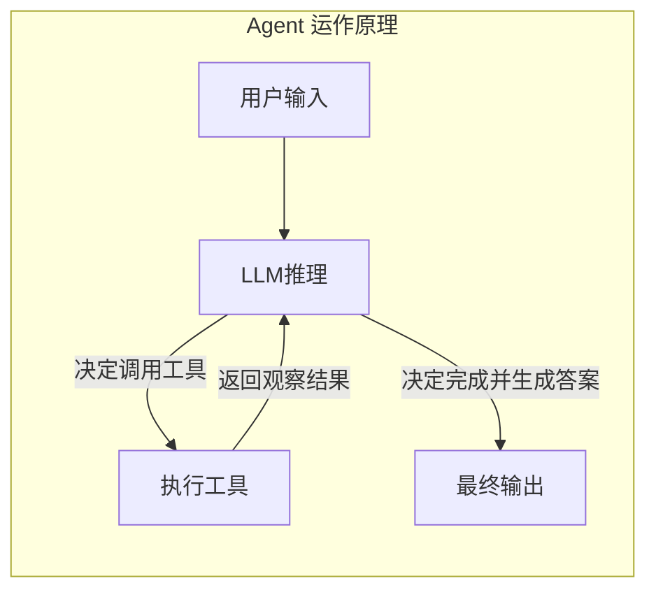
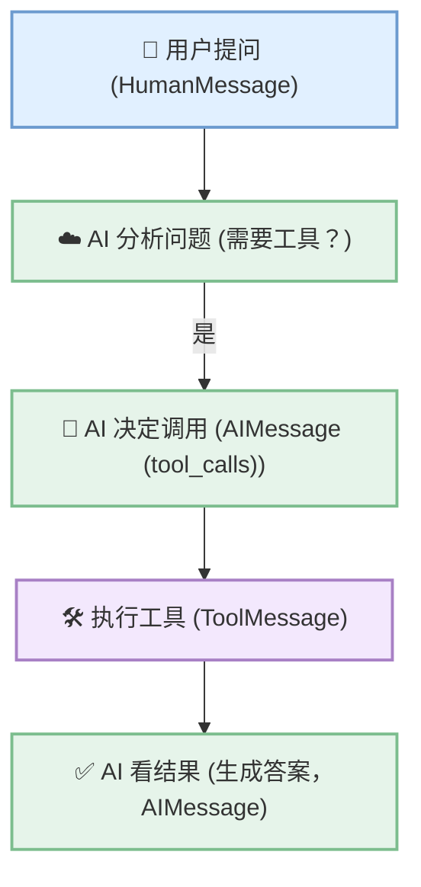

# Agent创建与基本用法

## 1. 理解智能体

通用人工智能（AGI）将是AI的终极形态，几乎已成为业界共识。同样，构建智能体(Agent)则是AI工程应用当下的“终极形态”，即Agent是大模型应用开发的核心。

## 什么是Agent？

在大模型应用开发中，智能体通常指一种以大语言模型为推理与决策核心，结合记忆、工具调用与环境交互能力，能够进行规划决策并执行复杂任务以达成目标的软件系统。

## 创建一个agent

```python
from langchain.chat_models import init_chat_model
from langchain.agents import create_agent

# 1. 初始化模型
model = init_chat_model("gpt-4o-mini", model_provider="openai")

# 2. 创建 agent（一步完成）
agent = create_agent(
    model=model,
    tools=[tool1, tool2],
    system_prompt="Agent 的行为指令"  # 可选
)

# 3. 调用
result = agent.invoke({
    "messages": [{"role": "user", "content": "问题"}]
})
```

## 2. Agent的基本用法1：模型的传入方式

### 2.1 传入模型字符串

```python
from dotenv import load_dotenv
from IPython.display import Image, display
from langchain.agents import create_agent
from rich import print as rprint

load_dotenv(override=True)
agent = create_agent(
    model = 'deepseek:deepseek-flash'
)
rprint(type(agent))

display(Image(agent.get_graph().draw_mermaid_png()))
```

### 2.2 传入模型对象

```python
from dotenv import load_dotenv
from IPython.display import Image, display
from langchain.agents import create_agent
from langchain.chat_models import init_chat_model
from rich import print as rprint

load_dotenv(override=True)
model = init_chat_model(
    model = "deepseek:deepseek-flash"
)
agent = create_agent(
    model = model
)
rprint(type(agent))

display(Image(agent.get_graph().draw_mermaid_png()))
```

## 3. Agent的基本用法2：如何调用Agent

agent.invoke(）是Agent最基本的同步调用方法，它会阻塞程序执行直到返回最终结果。具体的：
+ 输入：传入的参数为字典类型，字典内通过`messages`字段传递消息列表
+ 输出：通过`invoke`调用agent，底层可能会经历多轮交互，返回的是完整的消息列表，被封装在字典中，是`messages`字段的值
```python
agent = create_agent(
    model = model
)

response = agent.invoke({
    "messages":[
        {"role":"system","content":"你是一个专业的助手"},
        {"role":"user","content":"你好"}
    ]
})

rprint(response)
```

也可以使用HumanMessage，SystemMessage这些方法传入信息

```python
from langchain_core.messages import HumanMessage, SystemMessage

agent = create_agent(model=model)

response = agent.invoke(
    {"messages": [
        SystemMessage(content="你是一个专业的翻译"),
        HumanMessage(content="你好，我想翻译成中文"),
    ]}
)

rprint(response)
```

## 4. Agent的基本用法3：绑定工具

Agent支持静态和动态绑定工具，后者需要用到中间件

调用自定义的工具：

```python
from langchain_core.tools import tool


@tool
def get_weather(location: str) -> str:
    """获取天气"""
    return f"{location}的天气是晴朗的"


agent = create_agent(model=model, tools=[get_weather])

response = agent.invoke(
    {
        "messages": [
            SystemMessage(
                content="你是一个查询天气的助手，如果问题与天气无关，你可以回答：我不能回答你的问题"
            ),
            HumanMessage(content="你好，北京的天气怎么样？"),
        ]
    }
)

rprint(response["messages"][-1].content)
```

调用内置工具：

```python
from langchain_tavily import TavilySearch

web_search = TavilySearch(
    max_results=3,
    tavily_api_key=os.getenv("TAVILY_API_KEY"),
)

agent = create_agent(model=model, tools=[web_search])

response = agent.invoke(
    {
        "messages": [
            HumanMessage(content="2024年诺贝尔物理学奖的获得者是谁？"),
        ]
    }
)

rprint(response["messages"][-1].content)

```

**注意：** tavily search需要安装包才能用，还需要去官网配置api key




### 重试机制

## 参考信息

- [[2026-10-11-AI知识地图]] — 学习路径中的位置：知识地图「第五步：应用开发」
- [[2026-10-14-LangChain工具调用]] — 配套：tools 参数直接消费该篇用 @tool 定义的工具，工具描述与参数 schema 决定 Agent 能否正确调用
