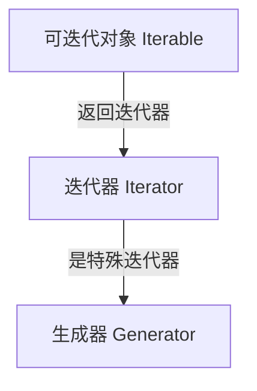

# 变量

# 标识符

## 标识符要求

- 只能由数字、字母、下划线组成
- 不能以数字开头
- 不能是关键字
- 严格区分大小写
- Python3版本可以使用中文作为标识符
- 标识符被包含在括号内对标识符本身没有影响

## 关键字

```python
['False', 'None', 'True', 'and', 'as', 'assert', 'async', 'await',
'break', 'class', 'continue','def', 'del', 'elif', 'else', 'except',
'finally', 'for', 'from', 'global', 'if', 'import', 'in','is', 'lambda',
'nonlocal', 'not', 'or', 'pass', 'raise', 'return', 'try', 'while',
'with', 'yield']
```

## 命名规范

- 见名知义
- 下划线分割法（常用）
- 大驼峰命名法
- 小驼峰命名法

# 数值类型

- int 整型
- folat 浮点型
- bool 布尔型，固定写法，严格区分大小写，True，False，布尔值可以当做整型对待，True相当于1，False相当于0
- complex 复数型，固定写法：z = a + bj
- string 字符串类型

# 格式化输出

## 占位符的作用

生成一定格式的字符串

## 占位符的三种方式

- `%s`(字符串)
- `%d`(整数)
- `%4d`(数字设置位置，不足前面补空白) 多个变量需要使用括号裹起来
- `%f`(浮点数) 默认小数点后6位 %.4f(设置为4位小数)
- `%%` 显示百分号
-  `format()`
-  格式化f
- 格式：f"{表达式}"

```python
def print_data():
	s = 2.123
	print("数字是：%05.2f" % s)# 小数点前面的5代表的是整个数字的长度，小数点后的2代表小数部分的长度

if __name__ == '__main__':
	print_data()# 输出 数字是：02.12
```

# 运算符

## 算数运算符

| 运算符  | 名称      | 示例       | 结果                | 说明  |
| ---- | ------- | -------- | ----------------- | --- |
| `+`  | 加       | `5 + 2`  | `7`               |     |
| `-`  | 减       | `5 - 2`  | `3`               |     |
| `*`  | 乘       | `5 * 2`  | `10`              |     |
| `/`  | **真除**  | `5 / 2`  | `2.5` **永远返回浮点数** |     |
| `//` | **整除**  | `5 // 2` | `2` 向下取整          |     |
| `%`  | **取模**  | `5 % 2`  | `1` 返回余数          |     |
| `**` | **幂运算** | `2 ** 3` | `8` 即 2323        |     |

## 赋值运算符

| 运算符   | 示例        | 等价于          |
| ----- | --------- | ------------ |
| `=`   | `a = 5`   | `a = 5`      |
| `+=`  | `a += 2`  | `a = a + 2`  |
| `-=`  | `a -= 2`  | `a = a - 2`  |
| `*=`  | `a *= 2`  | `a = a * 2`  |
| `/=`  | `a /= 2`  | `a = a / 2`  |
| `//=` | `a //= 2` | `a = a // 2` |
| `%=`  | `a %= 2`  | `a = a % 2`  |
| `**=` | `a **= 2` | `a = a ** 2` |

## 比较运算符

| 运算符 | 名称     | 示例     | 结果    |
|--------|----------|----------|---------|
| `==`   | 等于     | `5 == 5` | `True`  |
| `!=`   | 不等于   | `5 != 3` | `True`  |
| `>`    | 大于     | `5 > 3`  | `True`  |
| `<`    | 小于     | `5 < 3`  | `False` |
| `>=`   | 大于等于 | `5 >= 5` | `True`  |
| `<=`   | 小于等于 | `5 <= 3` | `False` |

## 逻辑运算符

| 运算符 | 名称 | 示例             | 说明               |
|--------|------|------------------|--------------------|
| `and`  | 与   | `True and False` | `False` (全真才真) |
| `or`   | 或   | `True or False`  | `True` (一真即真)  |
| `not`  | 非   | `not True`       | `False` (取反)     |

## 成员运算符

| 运算符   | 示例                 | 结果   | 说明            |
|----------|----------------------|--------|-----------------|
| `in`     | `'a' in 'apple'`     | `True` | 存在返回 True   |
| `not in` | `'b' not in 'apple'` | `True` | 不存在返回 True |

## 身份运算符

| 运算符   | 示例         | 说明                            |
|----------|--------------|---------------------------------|
| `is`     | `a is b`     | 如果 `id(a) == id(b)` 则为 True |
| `is not` | `a is not b` | 如果 `id(a) != id(b)` 则为 True |

## 位运算符

| 运算符  | 名称   | 示例 (假设 a=60, b=13) | 二进制逻辑            |
| ---- | ---- | ------------------ | ---------------- |
| `&`  | 按位与  | `a & b`            | 两位都为1才为1         |
| \|   | 按位或  | a \| b             | 只要有一位为1就为1       |
| `^`  | 按位异或 | `a ^ b`            | 两位不同为1，相同为0      |
| `~`  | 按位取反 | `~a`               | 0变1，1变0          |
| `<<` | 左移   | `a << 2`           | 二进制向左移2位 (相当于乘4) |
| `>>` | 右移   | `a >> 2`           | 二进制向右移2位 (相当于除4) |

## 运算符优先级

如果你在一行代码里混用了多种运算符，Python 会按以下顺序执行（括号 `()` 优先级最高）：

- 1 `()` 括号
- 2 `**` 幂
- 3 `~`, `+`, `-` (正负号)
- 4 `*`, `/`, `//`, `%`
- 5 `+`, `-` (加减)
- 6 `<<`, `>>` (移位)
- 7 `&` (位与)
- 8 `^` (位异或)
- 9 `|` (位或)
- 10 `==`, `!=`, `>`, `<`, `>=`, `<=`, `is`, `in` (比较/身份/成员)
- 11 `not` (逻辑非)
- 12 `and` (逻辑与)
- 13 `or` (逻辑或)

# 输入

`input(prompt)` prompt是提示，会在控制台中显示，没什么好说的，很简单

# 转义字符

没什么好说的，直接查就完事儿了

有一点，r代表的字符串不进行转义，如：`print(r'ttt\\\ttt')`，显示的就是 `'ttt\\\ttt`

# if判断

# 循环

## for循环

## while循环

## break和continue

# 字符串和列表[]

## 字符串编码转换

- encode()
- decode()

## 字符串常见操作

- find：返回查找字符或字符串的其实位置，不存在则返回-1
- count：返回某个子字符串在整个字符串中间出现的次数，没有就返回0
- replace：修改元素，replace(旧内容，新内容，替换次数)，次数不写默认全部替换
- split：制定分隔符切割字符串
- index：和find一样，但是不存在会报错
- capitalize：第一个字符大写
- startswith：是否以某个字符开头
- endwith：是否以某个字符结束
- lower：大写字符转为小写
- upper：小写字符转为大写

## 列表常见操作

### 添加元素

- append：整体添加
- extend：分散添加，将另一个类型中的元素逐一添加
- insert：在指定位置插入元素，必须指定位置

### 查找元素

- in
- not in
- index
- count

### 删除元素

- del：语句级删除（支持索引、切片、删除整个变量）
- pop：按索引删除并返回（默认删除最后一个）
- remove：按值删除（匹配第一个）

### 排序

- sort
- reverse

### 列表推导式

- 格式一：`[表达式 for 变量 in 列表]`
- 格式二：`[表达式 for 变量 in 列表 if 条件]`

# 元组()

# 字典{}

# 集合

集合名 = {元素1，元素2，元素3...}

集合官方定义是完全无序的，有时候int值看起来有序，是因为小整数哈希值就是它本身，顺序查询的时候就按照顺序打印出来了

集合里只能放可以被哈希的元素，字典由于是可变的，不能被哈希，所以不能作为集合的元素，同样的，其他可变的，不能被哈希的，同样不能放进集合中

# 类型转换

## 1. 转换为数字（int, float, complex, bool）

| 函数                  | 说明                                                                 | 示例                                        |
|-----------------------|----------------------------------------------------------------------|---------------------------------------------|
| `int(x)`              | 转为整数（截断小数、解析字符串数字）。支持进制参数 `int("FF", 16)`。 | `int("123")` → `123` <br>`int(12.9)` → `12` |
| `float(x)`            | 转为浮点数。                                                         | `float("3.14")` → `3.14`                    |
| `complex(real, imag)` | 转为复数。                                                           | `complex(1, 2)` → `(1+2j)`                  |
| `bool(x)`             | 转为布尔值（`False`：`None`、`0`、空容器；其余为 `True`）。          | `bool([])` → `False`                        |

## 2. 转换为字符串（str, repr, chr, ord, format）

| 函数              | 说明                                                      | 示例                          |
|-------------------|-----------------------------------------------------------|-------------------------------|
| `str(x)`          | 转为**人类可读**的字符串（调用 `__str__`）。              | `str(123)` → `"123"`          |
| `repr(x)`         | 转为**解释器可读**的字符串（用于调试，调用 `__repr__`）。 | `repr("hello")` → `"'hello'"` |
| `chr(i)`          | 将整数（Unicode 码点）转为**字符**。                      | `chr(65)` → `'A'`             |
| `ord(c)`          | 将**字符**转为 Unicode 码点（整数）。                     | `ord('A')` → `65`             |
| `format(x, spec)` | 按格式规范转为字符串（如进制、对齐）。                    | `format(255, 'x')` → `'ff'`   |

## 3. 转换为容器类型（list, tuple, set, dict, frozenset）

| 函数                  | 说明                                                | 示例                                                              |
|-----------------------|-----------------------------------------------------|-------------------------------------------------------------------|
| `list(iterable)`      | 转为列表。                                          | `list("abc")` → `['a','b','c']` <br>`list({1:2})` → `[1]`（仅键） |
| `tuple(iterable)`     | 转为元组。                                          | `tuple([1,2])` → `(1,2)`                                          |
| `set(iterable)`       | 转为集合（去重、无序）。                            | `set([1,2,2])` → `{1,2}`                                          |
| `frozenset(iterable)` | 转为不可变集合（可哈希，能放进另一个集合）。        | `frozenset([1,2])`                                                |
| `dict(iterable)`      | 转为字典。可接受键值对元组列表或 `key=value` 参数。 | `dict([('a',1)])` → `{'a':1}`                                     |

## 4. 转换为字节/二进制（bytes, bytearray, bin, oct, hex）

| 函数           | 说明                                         | 示例                                          |
|----------------|----------------------------------------------|-----------------------------------------------|
| `bytes(x)`     | 转为不可变字节序列（需指定编码或整数列表）。 | `bytes("hi", 'utf-8')` → `b'hi'`              |
| `bytearray(x)` | 转为可变的字节序列。                         | `bytearray(3)` → `bytearray(b'\x00\x00\x00')` |
| `bin(x)`       | 转为二进制**字符串**（带 `0b` 前缀）。       | `bin(10)` → `'0b1010'`                        |
| `oct(x)`       | 转为八进制**字符串**（带 `0o` 前缀）。       | `oct(8)` → `'0o10'`                           |
| `hex(x)`       | 转为十六进制**字符串**（带 `0x` 前缀）。     | `hex(255)` → `'0xff'`                         |

## 5. 隐式类型转换（自动发生）

Python 在运算时会自动提升类型，防止精度丢失：

- **整数 + 浮点数** → 自动转为浮点数（`1 + 1.0` → `2.0`）。
- **布尔参与运算** → `True` 视为 `1`，`False` 视为 `0`（`True + 1` → `2`）。

**注意**：Python **不支持**字符串和数字的隐式相加（`"1" + 1` 会直接报错，必须显式转 `int`）。

# 深浅拷贝

## 浅拷贝copy()

拷贝最外层的对象，内部元素只拷贝了一个引用

## 深拷贝deepcopy()

外层的对象和内部的元素都拷贝了一遍

# 可变对象和不可变对象

## 1. 不可变对象（Immutable）—— 修改即新建

一旦创建，其内容就**永远无法修改**。任何“修改”操作（如拼接、替换）都会在内存中创建一个**新的对象**，并将变量指向新地址。

- **数值类型**：`int`（整数）、`float`（浮点数）、`complex`（复数）、`bool`（布尔值）
- **序列类型**：`str`（字符串）、`tuple`（元组）、`bytes`（字节串）
- **集合类型**：`frozenset`（冻结集合）
- **其他**：`None`

> **特别注意（元组的陷阱）**：元组本身是不可变的（不能增删元素），但如果元组内部包含了一个列表（可变对象），**这个列表的内容是可以被修改的**！此时元组的 `id` 虽然不变，但它“包含”的内容变了。

## 2. 可变对象（Mutable）—— 原地修改

创建后，你可以**在不改变 `id()` 的情况下**，增、删、改其内部元素。

- **序列类型**：`list`（列表）、`bytearray`（字节数组）
- **集合类型**：`set`（集合）、`dict`（字典）
- **自定义类的实例**（默认情况下，属性可以随时增删改）

# 函数基础

## 必备参数

## 默认参数

## 可变参数

`*args`

## 关键字参数

`**kwargs`

# 函数进阶

## 作用域

### 全局变量

### 局部变量

## 匿名函数

- 语法：函数名 = lanbda 形参:返回值

## 内置函数

## 拆包

含义：对于函数中的多个返回数据，去掉元祖，列表或者字典，直接获取里面数据的过程

# 异常

```python
try:
	print(login())
except Exception as e:
	print(e)
```

# 闭包

闭包必须满足三个硬性条件（少一个都不叫闭包）：

1. **有嵌套函数**：一个函数里面定义了另一个函数（内层函数）。
2. **内层函数引用了外层函数的变量**（捕获外部环境）。
3. **外层函数把内层函数作为返回值返回**。

# 装饰器

含义：装饰器本质上时一个Python函数，它可以让其他函数在不需要做任何代码变动的前提下增加额外功能，装饰器的返回值也是一个函数对象

装饰器需要满足以下两点：
- 1、不修改源程序或函数的代码
- 2、不改变函数或程序调用方法

# 面向对象基础

示例属性和类属性的区别：
- 类属性属于类，是公共的，大家都能访问
- 实例属性属于对象，是私有的，只能由实例名访问，不能由类型访问

与java不同，在python中可以随意给实例化对象添加类中没有的属性和方法，因为Python创建对象是动态的，是一个动态的字典，因此你可以给实例随意添加属性和方法

但是在添加方法的时候需要注意，如果新增的方法中需要获取类中的属性，就不能直接使用赋值的方法给对象添加方法，需要使用示例方法进行添加

## 构造函数__init__

## 析构函数__del__

析构方法__del__是对象在被垃圾回收的时候起作用的，一个方法，它的执行一般也就意味着对象不能够继续引用，回收内存

## 封装

给类隐藏属性，只允许在类的内部使用，无法通过对象访问，在属性名或者方法名前面加上两个下划线__

如果需要访问私有属性，有两种方法：
- 第一种：`_类名__属性名`
- 第二种：在类中定义方法

私有属性：声明私有属性/方法，如果定义在类中，外部可以使用，子类也可以集成
但是在另一个py文件中通过from xxx import * 导入时，无法导入
一般是为了避免与Python关键字冲突采用的命名方法

## 继承

### 单继承

### 多继承

多继承：子类可以拥有多个父类，并且具有所有父类的属性和方法

如果是多继承的情况，建议子类使用super()重写父类方法，这样可以解决菱形继承

### 多重继承

### 方法的重写

```python
# 1. 父类（基类）
class Animal:
	def speak(self):
	return "动物发出声音"

# 2. 子类（派生类）继承 Animal
class Dog(Animal):
	# 重写（Override）父类的 speak 方法
	def speak(self):
	return "汪汪！"

# 3. 使用
animal = Animal()
dog = Dog()

print(animal.speak()) # 输出：动物发出声音
print(dog.speak()) # 输出：汪汪！

class Cat(Animal):
	def speak(self):
	parent_sound = super().speak() # 先调用父类方法
	return parent_sound + "，但我是猫，喵喵~"

c = Cat()
print(c.speak()) # 输出：动物发出声音，但我是猫，喵喵~
```

### 新式类 class A(object)

继承了object类或者该类的子类都是新式类，object为所有所有对象的积累，提供了一些内置的属性和方法，可以使用dir()查看

## 多态

### 多态的特点
 1、不关注对象的类型，关注对象具有的行为，也就是对象的实例方法是否同名
 2、多态的好处可以增加代码的外部调用灵活度，让代码更加通用，兼容性比较强
 3、不同的子类对象，调用相同的父类方法，会产生不同大的执行结果

# 静态方法

使用@staticmethod来进行修饰，静态方法没有self，cls参数的限制

静态方法与类无关，可以被转换成函数使用

静态方法既可以使用对象访问，也可以使用类访问

调用方法时传参，取消不必要的参数传递，有利于减少不必要的内存占用和性能消耗

## 定义格式

```python
class 类名
	@staticmethod
	def 方法名(形参)：
		方法体
```

## 调用格式

类名.方法名(实参)
对象名.方法名(实参)

# 类方法

## 定义格式

```python
class 类名
	@classmethod
	def 方法名(cls, 形参)：
		方法体
```

## 调用格式

类名.方法名(实参)
对象名.方法名(实参) ---不常用

对于类方法，第一个参数必须是类对象，一般是以cls作为第一个参数

类方法内部可以访问类属性，或者调用其他方法

当方法中需要使用到类对象(如访问私有类属性等)，定义类方法
类方法一般是配合类属性使用

# 实例方法，类方法，静态方法比较

+ [[2026-09-10-Python常用代码示例合集#实例方法，类方法，静态方法比较]]

#  \_\_new__()

1、在内存中为对象分配空间
2、返回对象的引用

重写方法时需要使用super重写__new__()，并且要传入cls参数，最后还需要返回这个实例对象的引用
[[2026-09-10-Python常用代码示例合集#__new__()]]

相当于java中的new 类()

# 单例模式

+ 含义：是一种常用的软件设计模式，该模式的主要目的是确保某一类只有一个实例存在。当你希望在整个系统中，某个类只能出现一个实例时，单例模式就能排上用场
+ 优点：可以节省内存空间
+ 弊端：多线程访问的时候容易引发线程安全的问题

## 实现方式

1. 通过@classmethod
2. 通过装饰器实现
3. 通过重写__new__()实现 (重点)
4. 通过导入模块实现

代码示例：
[[2026-09-10-Python常用代码示例合集#重写__new__()方法]]
[[2026-09-10-Python常用代码示例合集#使用模块导入]]
[[2026-09-10-Python常用代码示例合集#使用@classmethod注解]]

应用场景：
1、 回收站对象
2、音乐播放器
3、开发游戏软件
4、数据库配置、数据库连接池的设计

# 魔法方法

含义：在Pyhton中，\_\_xx__()的函数叫做魔法方法，指的是具有特殊功能的函数

1. `__new__()`: 在内存中为对象分配空间并返回对象的引用
2. `__init__()`: 初始化对象或给属性赋值(构造函数)
3. `__doc__()`: 类的描述信息
4. `__module__()`: 表示当前操作对象所在模块
5. `__class__()`: 表示当前操作对象所在的类
6. `__str__()`: 对象的描述信息
7. `__del__()`: 删除对象(析构函数)
8. `__call__()`: 使一个实例对象成为一个可调用对象
9. `__dict__()`: 返回对象具有的属性和方法

# 文件读写

## 基础操作

步骤：
1、打开文件
2、读、写文件
3、关闭文件

属性：
文件名.name:放回要打开文件的文件名，可以包含文件的具体路径
文件名.mode:返回文件的访问模式
文件名.closed:检测文件是否关闭，关闭就返回True

方法：
1、open():创建一个file对象，默认是以只读模式打开
2、read(n):n表示从文件中读取的数据的长度，没有传n值就默认一次性读取文件的所有内容
3、readline():一次读取一行内容
4、readline(n):按照行的方式一次性读取全部内容
5、write():将指定内容写入文件
6、close():关闭文件
7、tell():显示文件内当前位置，即文件指针当前位置
8、seek(offset,whence):移动文件读取指针到指定位置，offset：偏移量，表示要移动的字节数，whence：起始位置，表示移动字节的参考位置，默认是0,0代表文件开头作为参考位置，1代表当前位置作为参考位置，2代表将文件结尾作为参考位置，seek(0,0)就会把文件指针移到文件开头

## 读写操作

### 读写模式

- **r**：只能读；若文件不存在 → 报错；是否覆盖 → -
- **r+**：可读可写；若文件不存在 → 报错；是否覆盖 → 是
- **w**：只能写；若文件不存在 → 创建；是否覆盖 → 是
- **w+**：可读可写；若文件不存在 → 创建；是否覆盖 → 是
- **a**：只能写；若文件不存在 → 创建；是否覆盖 → 否（追加写）
- **a+**：可读可写；若文件不存在 → 创建；是否覆盖 → 否（追加写）

## with open

作用：代码执行完，系统会自动调用f.close()，可以省略文件关闭步骤，代码示例：[[2026-09-10-Python常用代码示例合集#with open]]

## 编码格式

注意：file对象的encoding参数的默认值与平台有关，比如windows上默认字符编码为GBK
encoding表示编码集，根据文件的实际保存编码进行获取数据，对于我们而言，使用更多的是utf-8


## 目录常用操作

1. 文件重命名: os.rename(旧文件名，新文件名)
2. 删除文件: os.remove(目标文件名)
3. 创建文件夹: os.mkdir(文件夹名)
4. 获取当前目录: os.getcwd()
5. 获取目录列表: os.listdir(目录)
6. 删除文件夹: os.rmdir(文件夹名)

# 迭代器，生成器

如何判断一个对象是否为可迭代对象？
使用isinstance()方法
示例：[[2026-09-10-Python常用代码示例合集#isinstance()]]

迭代器含义：迭代器是一个可以记住遍历位置的对象，迭代器对象从集合的第一个元素开始访问，直到所有的元素被访问完结束。迭代器只能往前不会后退

## 自定义迭代器

定义一个类，在类中重写__iter__()和__next__()方法

## 生成器

python中一边循环一边计算的机制，叫做生成器


## 生成器表达式

```python
gen = (i*5 for i in range(5)) # 生成的是一个迭代器对象，可以直接使用next()方法取值
```

## 生成器函数

使用了yield的函数被称为生成器

yield的作用：
1、类似return，将指定值或者多个值返回给调用者
2、yieId语句一次返回一个结果，在每个结果中间，挂起函数，执行next()，再重新从挂起点继续往下执行

示例：[[2026-09-10-Python常用代码示例合集#生成器函数]]

## 三者的关系



# 线程
## 阻塞线程

见示例：[[2026-09-10-Python常用代码示例合集#阻塞线程]]

## 资源竞争

见示例：[[2026-09-10-Python常用代码示例合集#线程竞争]]

## 线程同步

### join()

### 互斥锁

概念：对共享数据进行锁定，保证多个线程访问共享数据不会出现数据错误的问题，保证同一个时刻只能有一个线程去操作

方法：
acquire():上锁
release():释放锁

注意：这两个方法必须成对出现，否则容易形成死锁
互斥锁是多个线程一起去抢，抢到锁的线程先执行

示例：[[2026-09-10-Python常用代码示例合集#互斥锁]]

# 进程

是操作系统进行资源分配和调度的基本单位，是操作系统结构的基础

## 进程的状态

1. 就绪状态：运行的条件都已满足，正在等待cpu执行
2. 执行状态：cpu正在执行其功能
3. 等待（阻塞）状态：等待某些条件满足，如一个程序sleep了，此时就处于等待状态

## 进程的语法结构

multiprocessing模块提供了Process类代表进程对象

### Process类

参数：
+ target：执行的目标任务名，即子进程要执行的任务
+ args：以元组的形式传参
+ kwargs：以字典的形式传参

常用方法：
+ start():开启子进程
+ is_alive():判断子进程是否活着，存活返回True，死亡返回False
+ join():主进程等待子进程执行结束

常用属性：
+ name:当前进程的别名，默认Process-N
+ pid:当前进程的进程编号

示例：[[2026-09-10-Python常用代码示例合集#进程Process用法]]

## 进程间的通信

Queue(队列)

q.put(): 放入数据  
q.get(): 取出数据  
q.empty(): 判断队列是否为空  
q.qsize(): 返回当前队列包含的消息数量  
q.full(): 判断队列是否满了

示例：[[2026-09-10-Python常用代码示例合集#队列Queue]]

示例：[[2026-09-10-Python常用代码示例合集#进程间的通信]]

# 协程

协程，又称微线程，纤程。英文名Coroutine。

协程是python中另外一种实现多任务的方式，只不过比线程更小、占用更小执行单元（理解为需要的资源）。它自带CPU上下文。这样只要在合适的时机，我们可以把一个协程切换到另一个协程。只要这个过程里保存或恢复CPU上下文那么程序还是可以运行的。

## 简单实现协程

生成器就是一种协程

## greenlet模块

为了更好使用协程来完成任务，python中的greenlet模块对其封装，从而使得切换任务变的更加简单

安装命令：pip install greenlet

不建议使用。。。。

## gevent

### 核心概念与原理

`gevent` 的核心是**协程（Coroutine）**，一种比线程更轻量级的并发执行单元。

- **底层基石：`greenlet`**：`gevent` 建立在 `greenlet` 库之上[](https://www.gevent.org/intro.html#lightweight-pseudothreads)。`greenlet` 提供了协程的基本单元，但需要手动切换。
- **自动调度：事件循环（Event Loop）**：`gevent` 在 `greenlet` 之上增加了**事件循环**机制，基于高性能的 `libev` 或 `libuv` 实现[](https://www.gevent.org/intro.html#lightweight-pseudothreads)。当一个协程因 I/O 操作（如网络请求）而阻塞时，事件循环会自动挂起它，并切换到另一个可运行的协程[](https://raw.githubusercontent.com/runnerliu/blogs/refs/heads/main/articles/py-gevent.md#1)。I/O 操作完成后，再适时切换回来继续执行。这实现了**协作式多任务**。
    

### 主要特性

- **轻量级执行单元**：`greenlet` 协程的创建和切换开销远小于系统线程[](https://www.gevent.org/intro.html#lightweight-pseudothreads)。
- **熟悉的 API**：API 设计参考了 Python 标准库，并提供了 `events`、`queues` 等同步工具[](https://www.gevent.org/intro.html#lightweight-pseudothreads)[](https://developer.aliyun.com/article/1477497)。
- **猴子补丁（Monkey Patching）**：可以将 Python 标准库中阻塞的 I/O 操作替换为协作式版本[](https://www.gevent.org/intro.html#lightweight-pseudothreads)。
- **内置网络支持**：提供自己的 `socket`、`ssl`、`HTTP` 等模块，支持 TCP/UDP 服务器[](https://www.gevent.org/intro.html#lightweight-pseudothreads)[](https://cloud.baidu.com/article/3330936)。
- **DNS 解析**：支持通过线程池等方式进行协作式 DNS 查询[](https://www.gevent.org/intro.html#lightweight-pseudothreads)。
- **子进程与线程池**：支持子进程管理[](https://www.gevent.org/intro.html#lightweight-pseudothreads)和集成标准库的线程池[](https://www.gevent.org/intro.html#lightweight-pseudothreads)。

### 核心用法与示例
#### 基本并发：`spawn` 和 `joinall`
```python
import gevent

def task(name):
    print(f'Task {name}: 开始')
    gevent.sleep(1)  # 模拟 I/O 操作，触发协程切换
    print(f'Task {name}: 结束')

# 创建并启动多个协程
jobs = [gevent.spawn(task, i) for i in range(3)]

# 等待所有协程完成
gevent.joinall(jobs)
```

输出：
```text
Task 0: 开始
Task 1: 开始
Task 2: 开始
Task 0: 结束
Task 1: 结束
Task 2: 结束
```

`gevent.sleep(1)` 和 `time.sleep(1)` 都表示“等待 1 秒”，但**阻塞的层级完全不同**：
- **`time.sleep(1)`**：阻塞**整个操作系统线程**。在等待期间，该线程上的所有代码（包括 gevent 的事件循环和其他 greenlet）都无法运行。
- **`gevent.sleep(1)`**：只挂起**当前 greenlet**，并主动把控制权交还给 gevent 的事件循环。事件循环会立即去调度其他可运行的 greenlet，实现协作式并发。

#### 猴子补丁

这是 `gevent` 最强大的功能。通过在程序开头调用 `monkey.patch_all()`，可以让许多原本阻塞的库（如 `socket`, `urllib`）自动变为非阻塞。

示例：[[2026-09-10-Python常用代码示例合集#猴子补丁]]

经过猴子补丁后，多个 `urllib.request.urlopen()` 调用可以并发执行，总耗时接近最慢的那个请求，而不是所有请求时间的总和。

# 正则基础

## 正则表达式

含义：记录文本规则的代码
注意：需要导入re模块
步骤：
1. 导入re模块
2. 使用match方法进行匹配操作
   re.match() 能匹配出以xxx开头的字符串
   如果起始位置没有匹配成功，返回None
3. 如果上一步数据匹配成功，使用group()提取数据

## 匹配单个字符

|字符|功能|
|---|---|
|`.`|匹配任意1个字符（除了\n）|
|`[]`|匹配[ ]中列举的字符|
|`\d`|匹配数字，即0-9|
|`\D`|匹配非数字，即不是数字|
|`\s`|匹配空白，即 空格，tab键|
|`\S`|匹配非空白|
|`\w`|匹配单词字符，即a-z、A-Z、0-9、_|
|`\W`|匹配非单词字符|

## 匹配多个字符

## 匹配开头结尾

## 匹配邮箱示例

[[2026-09-10-Python常用代码示例合集#正则表达式匹配邮箱格式]]

# 内置模块

# os模块

作用：用于与操作系统进行交互
通用操作：
1、获取平台信息
2、对目录的操作
3、判断操作

示例：[[2026-09-10-Python常用代码示例合集#os模块的一些方法]]

## 参考信息

- [[2026-09-10-Python常用代码示例合集]] — 本文讲到的面向对象、生成器、线程与正则，在该文件中都有可运行示例
- [[2026-09-18-Django设计模式与视图基础]] — 视图用到的 `@require_http_methods` 等装饰器，可对照本文的装饰器基础
- [[2026-09-18-Django-ORM模糊查询]] — ORM 的 `regex` / `iregex` 查询直接依赖本文的正则表达式语法
- [[2026-09-15-Django配置Argon2id密码哈希]] — Argon2 的 `parallelism` 参数涉及多线程，可结合本文线程章节理解
