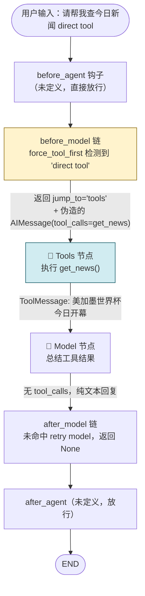
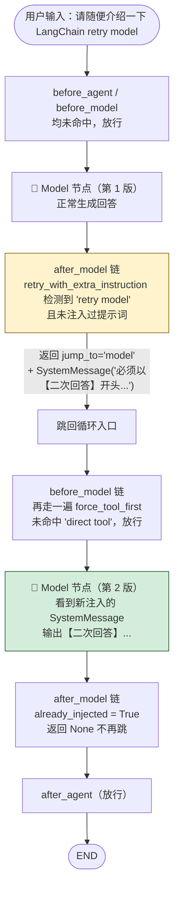
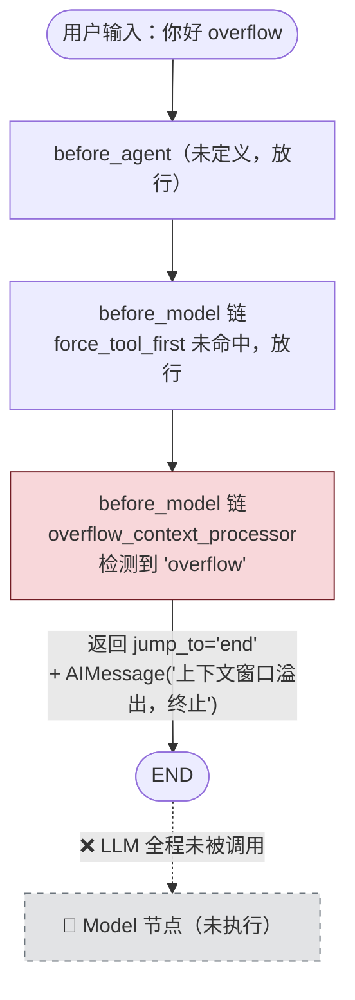
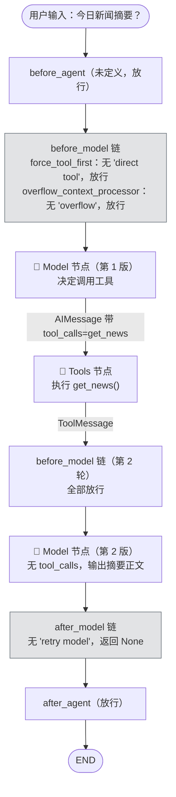

# 基于类实现自定义中间件

```python

from typing import Any

from langchain.agents import AgentState, create_agent
from langchain.agents.middleware import AgentMiddleware
from langchain_core.messages import HumanMessage
from langgraph.runtime import Runtime


class MyMiddleware(AgentMiddleware):
    def before_agent(self, state: AgentState, runtime: Runtime) -> dict[str, Any] | None:
        state["messages"][-1].content += "---> before_agent <---"
        return None

    def after_agent(self, state: AgentState, runtime: Runtime) -> dict[str, Any] | None:
        state["messages"][-1].content += "---> after_agent <---"
        return None

    def before_model(self, state: AgentState, runtime: Runtime) -> dict[str, Any] | None:
        state["messages"][-1].content += "---> before_model <---"
        return None
        
    def after_model(self, state: AgentState, runtime: Runtime) -> dict[str, Any] | None:
        state["messages"][-1].content += "---> after_model <---"
        return None


my_middleware = MyMiddleware()
agent = create_agent(
    model = model,
    middleware = [my_middleware],
)

response = agent.invoke(
    {
        "messages": [
            HumanMessage(content="你好")
        ]
    }
)

for msg in response["messages"]:
    msg.pretty_print()


```

1. `before_model`通用的场景：
	+ 消息修剪(trim messages)
	+ Pll脱敏
	+ 输入验证
	+ 条件路由
2. `after_model`通常的场景:
	+ 输出验证
	+ 格式化响应
	+ 统计信息
	+ 状态更新

**state:** 是一个AgentState实例，维护Agent运行过程中的状态，这类状态会随着Agent的运行而发生变化，包括消息列表。
**runtime:** 是一个Runtime实例，维护Agent运行过程中的上下文环境，包括上下文、长期记忆等。

# 装饰器参数: can_jump_to

钩子函数可以改变Agent正常的运行轨迹。比如：发现上下文窗口溢出，直接跳转至结尾，提前终止整个Agent。

`can_jump_to`决定了钩子函数可以直接跳转至流程的哪些位置，可取如下：

- **end**：跳转至Agent流程末尾，或第一个after_agent钩子，直接终止整个流程。
    
- **tools**：跳转至工具节点。
    
- **model**：跳转至模型节点，或第一个before_model钩子。

## 基于装饰器实现

参考代码：

```python
from typing import Any

from langchain.agents import create_agent
from langchain.agents.middleware import before_model, after_model, AgentState
from langchain.messages import AIMessage, SystemMessage
from langchain.tools import tool
from langgraph.runtime import Runtime


@tool
def get_news() -> str:
    """获取当日新闻"""
    return f"美加墨世界杯今日开幕"


# 在模型（LLM）执行前触发。允许跳转到 "tools" 节点。
@before_model(can_jump_to=["tools"])
def force_tool_first(state: AgentState, runtime: Runtime) -> dict[str, Any] | None:
    """
    【业务场景：强行拦截并触发工具】
    如果用户输入包含 "direct tool"，则跳过本次大模型的思考/生成阶段，
    直接伪造一个大模型的 tool_calls 意图，强行把控制权移交给工具执行节点。
    """
    text = state["messages"][-1].content
    # 检查关键词，满足条件则强行干预流程
    if isinstance(text, str) and "direct tool" in text.lower():
        print("[MIDDLEWARE] before_model: jump_to='tools'")

        # 人工构造一个大模型的消息对象（AIMessage）
        # 欺骗系统，让系统误以为这是模型自己决定要调用的工具
        fake_tool_call = AIMessage(
            content="人工构造的消息",
            tool_calls=[
                {
                    "name": "get_news",
                    "args": {},
                    "id": "call_force_weather_001",
                }
            ],
        )

        # 返回更新后的状态：注入伪造的消息，并明确指定下一步跳转到 "tools" 节点
        return {
            "messages": [fake_tool_call],
            "jump_to": "tools",
        }
    # 如果不满足触发条件，返回 None，流程正常向下流转（继续让 LLM 思考）
    return None

# 在模型（LLM）执行生成之后触发。允许重新跳转回 "model" 节点。
@after_model(can_jump_to=["model"])
def retry_with_extra_instruction(state: AgentState, runtime: Runtime) -> dict[str, Any] | None:
    """
    【业务场景：反思/重试机制】
    如果大模型已经生成了回答，但发现用户最初的请求包含 "retry model"，
    则动态追加一条系统提示词（SystemMessage），强行让模型重新生成（重试）一次。
    """
    # 倒序遍历消息历史，找到最近的一次用户输入（human 消息）
    user_text = ""
    for msg in reversed(state["messages"]):
        if getattr(msg, "type", "") == "human":
            user_text = getattr(msg, "content", "")
            break

    # 检查用户输入是否包含触发重试的关键字
    if isinstance(user_text, str) and "retry model" in user_text.lower():
        # 【核心防御】：防止无限循环重跳（死循环）
        # 检查消息历史中是否已经注入过这条特殊的系统提示。如果有，说明已经重试过了，不再重复干预。
        already_injected = any(
            isinstance(getattr(msg, "content", None), str)
            and "你必须以【二次回答】开头" in msg.content
            for msg in state["messages"]
        )
        if already_injected:
            return None # 已注入过，直接放行，结束重试流程

        print("[MIDDLEWARE] after_model: jump_to='model' with extra system instruction")

        # 返回更新后的状态：追加强力约束的系统消息，并将指针跳回 "model" 节点重新执行
        return {
            "messages": [
                SystemMessage("你必须以【二次回答】开头，并且只用一句话回答。")
            ],
            "jump_to": "model",
        }

    return None

# 在模型（LLM）执行前触发。允许直接跳转到 "end" 节点（强行终止）。
@before_model(can_jump_to=["end"])
def overflow_context_processor(state: AgentState, runtime: Runtime) -> dict[str, Any] | None:
    """
    【业务场景：安全卫士/异常拦截】
    模拟上下文窗口溢出（Token超限）或其他严重的系统阻断情况。
    一旦触发，直接熔断流程，拒绝让大模型继续处理，直接报错或返回兜底文案。
    """

    # 假装溢出,模拟检查最后一条消息是否包含 overflow 标识
    if "overflow" in state["messages"][-1].content:
        print("[MIDDLEWARE] before_model: jump_to='end' when contenxt window overflow")

        # 构造兜底的结束消息，并直接指定跳转到 "end" 终止 Agent 运行
        return {
            "messages": [
                AIMessage("上下文窗口溢出，终止")
            ],
            "jump_to": "end",
        }


agent = create_agent(
    model=model,
    tools=[get_news],
    # # 将定义的中间件按照顺序挂载到 Agent 中（注意：执行顺序会严格按照列表声明顺序）
    middleware=[force_tool_first, retry_with_extra_instruction, overflow_context_processor],
)


def run_once(user_input: str):
    result = agent.invoke(
        {
            "messages": [
                {"role": "user", "content": user_input}
            ]
        }
    )

    for msg in result["messages"]:
        msg.pretty_print()


if __name__ == "__main__":
    # Case 1: 直接跳 tools
    # 预期表现：
    # 1. 触发 force_tool_first，打印 "[MIDDLEWARE] before_model: jump_to='tools'"
    # 2. 绕过 LLM 的首轮思考，直接调用 `get_news` 工具
    # 3. 工具返回结果后，LLM 总结工具结果并输出
    print('=' * 30, '-> Case 1 <-', '=' * 30)
    run_once("请帮我查今日新闻 direct tool")

    # Case 2: 输出后跳回 model
    # 预期表现：
    # 1. 正常进入 LLM 生成第 1 版回答
    # 2. 触发 retry_with_extra_instruction，打印 "[MIDDLEWARE] after_model: jump_to='model'..."
    # 3. 注入系统提示词后，LLM 被强行拉回并生成第 2 版回答
    # 4. 最终输出应带有“【二次回答】”前缀
    print('=' * 30, '-> Case 2 <-', '=' * 30)
    run_once("请随便介绍一下 LangChain retry model")

    # Case 3:
    # 预期表现：
    # 1. 触发 overflow_context_processor 中间件
    # 2. 直接打印终止信息并退出，LLM 根本不会接收到这个请求
    print('=' * 30, '-> Case 3 <-', '=' * 30)
    run_once("你好 overflow")

    # Case 4: 正常流程
    # 预期表现：
    # 1. 没有任何中间件被触发（不满足任何关键字）
    # 2. Agent 走正常的 OOTB（Out of the box）标准工作流：User -> Model -> Call Tool -> Model -> End
    print('=' * 30, '-> Case 4 <-', '=' * 30)
    run_once("今日新闻摘要？")
```










# Wrap-style hooks函数用法


## 1、wrap_model_call的使用

用于拦截、重试、缓存模型调用

### 1.1 基于装饰器的实现

### 1.2 基于类的实现

## 2、wrap_tool_call的使用

### 2.1 基于装饰器的实现

### 2.2 基于类的实现

# 装饰器和类的选择

情况1：中间件只用一个钩子函数，推荐用装饰器，需要多个钩子函数推荐类写法
情况2：复杂配置推荐用类实现
情况3：跨项目复用推荐用类写法

# hook函数执行顺序

分类讨论
before_* 钩子函数：从前到后执行
after_* 钩子函数：从后往前执行
wrap_* 钩子函数：洋葱架构，前面的包裹后面的

```python
agent = create_agent(
    model=model,
    middleware=[
        before_model_middleware3,
        before_model_middleware1,
        before_model_middleware2,
        after_model_middleware2,
        after_model_middleware1,
        after_model_middleware3,
        wrap_model_middleware2,
        wrap_model_middleware3,
        wrap_model_middleware1,
    ]
)

"""
b3->b1->b2->w2->w3-w1
w1->w3->w2->a3->a1->a2
"""
```

