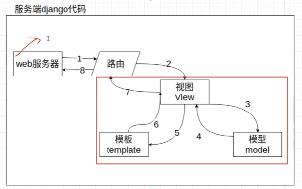

# 主流框架

重量级框架：Django
轻量级框架：FastAPI，flask，tornado，sanic，twsited 

# 使用uv安装Django

## 第一步：安装 uv

```bash
curl -LsSf https://astral.sh/uv/install.sh | sh
```

## 第二步：初始化项目并添加 Django

1. **创建项目并进入目录**

`uv`会自动创建项目结构、虚拟环境和`pyproject.toml`文件

```bash
uv init my-django-app
cd my-django-app
```

2. **添加 Django 依赖**

使用 `uv add` 命令安装 Django，它会自动更新 `pyproject.toml` 并安装到虚拟环境中。

```bash
uv add django
```

## 第三步：创建 Django 项目和应用

现在，使用 `uv run` 来执行 Django 的命令，它会确保命令在项目的虚拟环境中运行。

1. **创建 Django 项目**：  

推荐将项目配置目录命名为 `config`，并用 `.` 表示在当前目录创建。

```bash
uv run django-admin startproject config .
```

2. **创建一个应用**（例如 `blog`）：

```bash
uv run python manage.py startapp blog
```

3. **注册应用**：  

打开 `config/settings.py`，在 `INSTALLED_APPS` 列表中加入你的应用名。

```python
INSTALLED_APPS = [
    # ... 其他应用
    'blog',
]
```

## 第四步：应用数据库迁移并启动

1. **执行初始迁移**：

```bash
uv run python manage.py migrate
```

2. **启动开发服务器**：

```bash
uv run python manage.py runserver
```

现在，打开浏览器访问 `http://127.0.0.1:8000/`，你应该能看到 Django 的欢迎页面了。

# Pycharm 使用技巧

先在manage.py中，运行main函数，然后编辑运行配置文件，在形参中添加runserver 0.0.0.0:8000
之后直接在右上角点击运行即可运行服务

# 项目目录结构

```text
djdemo/                  # 项目根目录
├── manage.py            # 入口程序，终端脚本命令，提供了一系列用于生成文件或者目录的命令,也叫脚手架
└── djdemo/              # 主应用开发目录，保存了项目中的所有开发人员编写的代码，目录是生成项目时指定的
    ├── asgi.py          # django3.0以后新增的，用于让django运行在异步编程模式的一个web应用对象
    ├── settings.py      # 默认开发配置文件，将来填写数据库账号，密码等相关配置
    ├── urls.py          # 总路由文件,用于绑定django应用程序和url的映射关系
    ├── wsgi.py          # wsgi就是项目运行在wsgi服务器时的入口文件，本质上来说， manage.py runserver 内部调用的就是wsgi
    └── __init__.py      # 包初始化文件
```

# 视图函数views.py

**第一步：** 在views.py中编写返回视图函数
**第二步：** 在urls.py中导入应用的视图，并且配置路由，将视图绑定到路由上

如果是前后端隔离的，就不需要views视图了

# 网页的静态化和动态化

静态化经常使用在一些网站数据不经常改变的场景下，网站内容一经发布，几乎不会更新

网页静态化的优点：
1. 可以提高网页的访问速度
2. 减少服务端访问压力和数据库读写数据的压力
3. 提高网站的负载，容纳更多的用户访问进来
4. 静态化的内容更有利于像百度搜狗等搜索引擎的抓取和收录

网页静态化的缺点：
1. 数据不断新增导致静态网页数量剧增，带来一定的存储压力
2. 静态网网页往往不是人工新建更新，而是采用服务端语言新建更新的，所以当服务端负载上来以后，时刻生成新的静态化页面就会变成压死骆驼的最后一根草

动态化经常使用在一些网站数据经常改变的场景下，网站内容在发布以后，还会继续不断更新或修改，比如聊天网站、炒股网站等。

网页动态化的优点：
1. 解决静态化带来的服务端存储压力
2. 集中存储数据到存储设备中，有利于数据的存储与维护

网页动态化的缺点：
1. 封文速度比静态化慢
2. 每次客户端访问请求都会到达服务端和数据库层面

# MVC设计模式

_M-model_ :数据模型，和MVT的m是一样的，同样用来操作数据库
_V-view_:视图，和MVT的V是一样的，用来进行数据的可视化
_C-Controller_:控制器，相当于MVT中的T，用来进行数据的逻辑操作

# MVT设计模式

**Django**主要采用MVT模式

_M-model_: 模型，操作数据库功能部分。
_V-View_: 视图，处理业务逻辑的位置，提取数据、获取用户数据等等操作都在这里。
_T-Template_: 模版，用来展示视图操作后的数据，也可以在模版中为用户**提供表单**，让用户可以提交数据。

# @require_http_methods

作用：用于限制函数视图允许用户的http访问方法

```python
from django.http import HttpResponse  
from django.views.decorators.http import require_http_methods  
# Create your views here.  
  
@require_http_methods(['GET'])  
def index(request):  
    return HttpResponse("Hello World")
```

# 路由分层

为了避免将来视图函数太多导致无法明确区分哪些路由属于哪一个子应用的，我们可以现在刚开始项目的时候，把路由代码放回到对应的各个子应用目录下，单独存放，这就是django提供的路由分层

1. 在子应用home下创建子路由文件，一般路由文件名建议是urls.py
2. 把子应用home下面的视图绑定代码转到 home/urls.py

子模块urls按照正常写法写路由

```python
from django.urls import path  
from . import views  
  
urlpatterns = [  
    path('index/', views.index, name='index'),  
]
```

```python
from django.urls import path  
from . import views  
  
urlpatterns = [  
    path('goods/', views.goods, name='goods'),  
]
```

在总urls中将需要加的路由按照include加进来

```python
from django.contrib import admin  
from django.urls import path, include  
  
urlpatterns = [  
    path('admin/', admin.site.urls),  
    path('index/', include('blog.urls')),  
    path('goods/', include('goods.urls')),  
]
```

# 请求对象

## 视图接收http请求

```text
https://example.com:8000/path/page/?q=1&name=abc#section2
└─────┬────┘└──┬──┘└────┬────┘└────┬────┘└───┬───┘
   协议      主机      路径      查询参数    片段/锚点
```

>**url中的锚点：
> - `#` 是 **锚点/片段标识符**，属于客户端概念。
> - **不会发送给服务器**，Django 后端拿不到。
> - 常用于页面内跳转、SPA 路由、JS 读取。
> - 想传数据给后端，用 `?` 查询参数，不要用 `#`。
> - 表单 action、AJAX URL 里带 `#` 要小心，它会被浏览器丢弃。

URL中的参数只能通过GET方法传递，后端的request只能通过request.GET拿到
如果是在请求体中传递参数，那么后端只能通过request.POST拿到
但是不管是什么http请求，URL中的参数都能通过request.GET拿到  

```python
from django.http import HttpResponse  
from django.views.decorators.http import require_http_methods  
  
  
# Create your views here.  
  
@require_http_methods(['GET', 'POST'])  
def index(request):  
    for k, v in request.GET.lists():  
        print(f"key: {k}, value: {v}")  
    params = request.GET.dict()  # 普通 dict    
    data = request.POST.dict()  # 普通 dict    
    return HttpResponse(f"Hello World, get:{params}, post:{data}")
```

---

## 获取请求头

request.META

### 常见请求头

+ SERVER_NAME：服务端系统名称
+ SERVER_PORT：服务运行端口
+ REMOTE_HOST：客户端的所在IP地址，有时候可能是域名
+ REMOTE_ADDR：客户端的所在IP地址
+ SERVER_SOFTWARE：服务端运行web服务器的软件打印信息
+ PATH_INFO：客户端本次请求时的url路径

## 获取上传文件

request.FILES只能接受POST请求上传的文件，其他请求无法获取
可以接收一个文件，也可以多个文件同时接收

```python
@require_http_methods(['POST'])  
def index4(request):  
    print(request.FILES)  
    for file in request.FILES.getlist('file'):  
        with open(f"{os.path.dirname(__file__)}\\file\\{file.name}", "wb") as f:  
            f.write(file.read())  
    return HttpResponse(f"request.FILES:{request.FILES}")
    
"""
输出：
<MultiValueDict: {'body': [<InMemoryUploadedFile: MSI_MEG_ACE.jpg (image/jpeg)>]}>
并且将文件直接保存在file目录下
"""
```


# 响应对象

django和大多数的web框架一样，针对http的响应，提供了2种不同的响应方式：

1. 响应内容，就是直接返回数据给客户端
    1. 响应html内容【一般用于web前后端不分离的项目】
    2. 响应json内容【一般用于开发web前后端分离的项目的api接口开发】
2. 响应页面跳转，就是通过返回页面跳转的信息给浏览器，让浏览器自己进行页面跳转  

## 返回HTML数据

```python
def index5(request):  
    """  
    返回html代码  
    :param request:    :return: HTML code  
    """    
    return HttpResponse("<h1>HTML code</h1>", content_type="text/html", status=201, headers={"token":123})
```

## 返回JSON数据

```python
def index6(request):  
    data = [{  
            "name": "xiaoming",  
            "age": 21,  
        },  
        {  
            "name": "xiaohui",  
            "age": 22,  
        }]  
    return JsonResponse(data, safe=False)
```

JsonResponse并不支持直接返回列表转换json格式，需要将safe参数值修改为False

## 返回图片格式信息

```python
def index7(request):  
    with open("./blog/file/qr-code-url.png" , "rb") as f:  
        img = f.read()  
    return HttpResponse(img, content_type="image/png")
```

## 自定义响应头

```python
def index8(request):  
    response = HttpResponse("ok!!!")  
    response["token"] = 123456  
    response["time"] = time.strftime("%Y-%m-%d %H:%M:%S", time.localtime())  
    return response
```

## 页面跳转

### 站外跳转

```python
def index9(request):  
    return HttpResponseRedirect("https://www.163.com")
```

### 站内跳转

```python
def index10(request):  
    """  
    站内跳转  
    :param request:    :return:  
    """    
    url = reverse("home:index8")# reverse("namespacce:name"), namespace就是路径的前缀命名空间，name就是路径别名  
    return redirect(url)
```

# 会话控制技术

在web开发领域，网络中网页之间进行内容传输使用的协议是http/https协议。

http协议是一种无状态，有所请求必有所回应的超文本传输协议，HTTP为了提升效率，一经完成请求和响应的过程以后，就会自动关闭连接。所谓无状态意指：基于http协议提供服务的服务端,无法识别前后多次请求过程中,是不是同一个客户端发送的还是多个客户端发送的。

web开发的应用往往不仅仅只是一个网页或一个功能，那么怎么多个页面不同的请求，**识别用户之前的状态和行为**？

为了能在多次请求过程中,识别客户端是否是同一个客户端,所以就出现了会话跟踪技术，就需要使用会话控制技术,也叫会话保持或者会话跟踪技术.

会话控制技术，主要作用是为了识别和记录用户在web应用中的身份行为和操作历史.

## 会话

会话的单词：session，所谓**一次会话**其实就是客户端和服务端之间进行通信的一次完整过程。  
在web项目中：  
　　客户端和服务端之间产生的会话开始于：**在用户第一次输入url访问网站的时候**  
　　客户端和服务端之间的会话结束于**关闭浏览器**  
**注意**：如果在移动端下面，则必须是关闭当前app应用才算结束会话，如果只是后台运行，会话并没有结束的.  
所以会话跟踪技术就是在一次完整的会话中,能让服务端识别客户端在整个过程中的身份行为和操作历史的一项技术.

实现会话控制的几种技术类型
1. url地址栏记录用户身份的参数(少见，很古老的技术了，例如：QQ邮箱，QQ空间)
2. cookie: 在浏览器中由浏览器自动读写保存用户信息的一种小文件，能够存储的数据有限，30M左右，(过时了，谷歌在2021开始慢慢关闭这个cookie技术了)
3. session: 在服务端中保存用户信息的一种小文件，能够存储的数据有限，根据服务端配置而定。session默认是基于cookie的
4. token令牌: 就是一段可以记录和识别用户身份的字符串，通过客户端语言(js/安卓/ios)保存在客户端中一项技术，替代cookie或session,jwt就是token技术的一种，Oauth2.0也是基于token令牌技术的一种

# session的设置，获取和删除

```python
def set_session(request):  
    """  
    保存session  
    :param request:    :return:  
    """    request.session['name'] = "xiaoming"  
    request.session['id'] = 10  
    return HttpResponse('set_session')  
  
def get_session(request):  
    """  
    获取session  
    :param request:    :return:  
    """    print(dict(request.session))  
    return JsonResponse({  
        "session_key": request.session.session_key,  # cookie 里的标识  
        "name": request.session.get("name"),  
        "id": request.session.get("id"),  
    })  
  
def del_session(request):  
    """  
    删除session  
    :param request:    :return:  
    """    request.session.flush()  
    return HttpResponse('del_session')
```

---

# Argon2id
密码加密 [Argon2](Argon2.md)

# 路由进阶

## 正则路由 re_path

path和re_path 使用参数一直，仅仅在url参数和接收参数时写法不一样

```python urls.py
from django.urls import path, re_path  
from . import views  
  
app_name = 'goods'  
urlpatterns = [  
    re_path(r'goods/(?P<cat_id>\d+)/(?P<sttr_id>\d+)/', views.goods, name='goods'),  
]
```

```python views.py
from django.http import HttpResponse  
  
# Create your views here.  
def goods(request, cat_id, sttr_id):  
    return HttpResponse(f"Goods: cat_id = {cat_id}, sttr_id = {sttr_id}")
```

```bash
curl --location --request GET 'http://127.0.0.1:8000/home/goods/10/20/' \
--header 'User-Agent: Apifox/1.0.0 (https://apifox.com)' \
--header 'Accept: */*' \
--header 'Host: 127.0.0.1:8000' \
--header 'Connection: keep-alive'
```

## 路由转换器 

也叫路由验证器，有2个作用：
1. 把路由参数进行类型转换
2. 可以起到验证路由匹配的作用（让字符串路由path发挥正则路由re_path的作用）
[Django官方文档链接](https://docs.djangoproject.com/zh-hans/6.1/topics/http/urls/)

```python urls.py
from django.urls import path, re_path  
from . import views  
  
app_name = 'user'  
  
urlpatterns = [  
    re_path(r"^info/(?P<id>\d+)/", views.info),  
    path('phone/<int:phone_number>/', views.get_phone)  
    """
    下面的路径转换器在默认情况下是有效的：
	- `str` - 匹配除了 `'/'` 之外的非空字符串。如果表达式内不包含转换器，则会默认匹配字符串。
	- `int` - 匹配 0 或任何正整数。返回一个 `int` 。
	- `slug` - 匹配任意由 ASCII 字母或数字以及连字符和下划线组成的短标签。比如，`building-your-1st-django-site` 。
	- `uuid` - 匹配一个格式化的 UUID 。为了防止多个 URL 映射到同一个页面，必须包含破折号并且字符都为小写。比如，`075194d3-6885-417e-a8a8-6c931e272f00`。返回一个 [`UUID`](https://docs.python.org/3/library/uuid.html#uuid.UUID "(in Python v3.14)") 实例。
	- `path` - 匹配非空字段，包括路径分隔符 `'/'` 。它允许你匹配完整的 URL 路径而不是像 `str` 那样匹配 URL 的一部分。
]
"""
```

```python views.py
from django.http.response import HttpResponse  
from django.shortcuts import render  
  
# Create your views here.  
  
def info(request, id):  
    return HttpResponse(f"id = {id}")  
  
def get_phone(request, phone_number):  
    return HttpResponse(f"phone = {phone_number}")
```

>**注意：** str会包含uuid的模式，避免str和uuid同时使用时，str写在前面的情况出现

## 自定义转换器

步骤：
1. 自定义一个转换器类
```python convertersnim.py
from django.urls.converters import  StringConverter, register_converter  
  
class MobileConverter(StringConverter):  
    regex = r"1[3-9]\d{9}"  
  
register_converter(MobileConverter, 'mobile')
```
2. 在urls.py中导入自定义转换器类，并在路由中使用自定义转换器
```python urls.py
from django.urls import path, re_path  
from . import views  
from . import convertersnum  
  
app_name = 'user'  
  
urlpatterns = [  
    re_path(r"^info/(?P<id>\d+)/$", views.info),  
    path('phone/<mobile:phone_number>/', views.get_phone),  
    """
    mobile就是自定义的转换器
    """
]
```

### 更严谨的写法

步骤：
1. 在settings.py中，注册app
2. 在app中的apps.py，使用ready()函数导入自定义转换器
```python apps.py
from django.apps import AppConfig  
  
  
class UserConfig(AppConfig):  
    name = 'user'  
  
    def ready(self):  
        from . import convertersnum
```

# 配置文件

[配置 | Django 文档 | Django](https://docs.djangoproject.com/zh-hans/6.1/ref/settings/)

# 使用uvicorn提供ASGI服务

使用uvicorn目的是取代django调试时自己的web服务器，每次启动或者检测到代码改动后重启就巨慢
配置过程见：[uvicorn](uvicorn.md)
# 使用simplui

官网文档：[快速上手指南 | Django SimpleUI](https://newpanjing.github.io/simpleui_docs/config.html)

学习项目由于使用了uvicorn服务器提供web服务，导致启动时无法提供静态资源，需要安装whitenoise模块实现服务器提供静态文件服务

详细配置过程见：[Simpleui](Simpleui.md)

# Django框架流程



# Django模板引擎
## render()函数

[[render()函数]]详细使用逻辑

在实际应用中，可以将render生成的html文件写入缓存或者数据库，在调用接口的时候，先判断有没有生成的html文件，如果有的话直接读取并返回，没有的话再生成新的html文件返回，并保存至缓存或者数据库，这样可以提高访问效率

## DTL文件和普通的html文件有什么区别？

DTL模板文件是一种带有特殊语法的HTML文件，这个HTML文件可以被Django编译，可以从视图中传递参数进去，实现数据动态化。  
在编译完成后，生成一个普通的HTML文件，然后发送给客户端。

---
